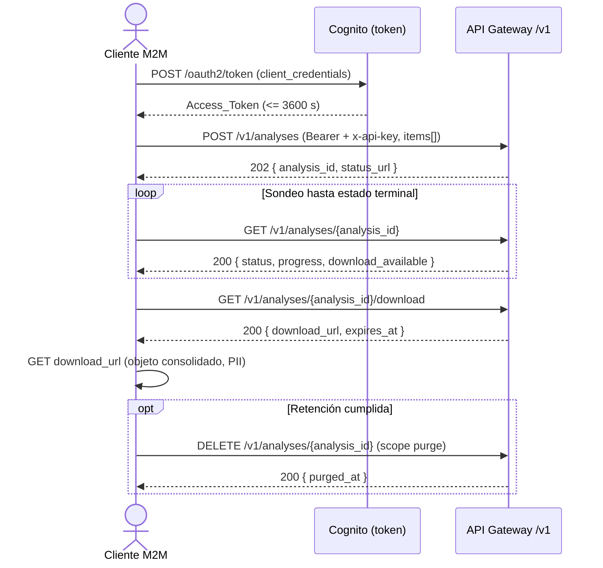

# API REST: serverless-sentiment-pipeline

Contrato público de la API REST del pipeline de análisis de sentimiento. Este
documento es la referencia de integración para un cliente M2M (sistema
automatizado) que envía Lotes de respuestas de encuesta, consulta su estado,
descarga el resultado consolidado y, opcionalmente, purga Lotes terminales.

Es la vista de contrato de la frontera HTTP descrita en la
[sección 8.6 de `ARCHITECTURE.md`](./ARCHITECTURE.md#86-stack-api-exposición-http);
los contratos de abajo están alineados byte a byte con los handlers reales
(`backend/src/sentiment/handlers/api_*.py`), sus servicios y el
Catalogo_De_Errores (`backend/src/sentiment/domain/errors.py`).

> **Seguridad y privacidad.** Todos los ejemplos usan *placeholders*
> (`<ACCESS_TOKEN>`, `<API_BASE_URL>`, …): nunca credenciales, endpoints, ARNs ni
> direcciones reales. El texto de `respuesta` y `explicacion` es PII; la API
> nunca lo devuelve en una respuesta de estado ni lo registra en logs. El cuerpo
> de descarga (que sí contiene PII) solo se sirve por una URL prefirmada de corta
> vida, bajo autenticación previa.

## Tabla de contenidos

- [1. Convenciones generales](#1-convenciones-generales)
  - [1.1 URL base y versionado](#11-url-base-y-versionado)
  - [1.2 Autenticación (OAuth2 `client_credentials`)](#12-autenticación-oauth2-client_credentials)
  - [1.3 Scopes y matriz de autorización](#13-scopes-y-matriz-de-autorización)
  - [1.4 Clave de API (`x-api-key`), throttling y cuotas](#14-clave-de-api-x-api-key-throttling-y-cuotas)
  - [1.5 Aislamiento multi-tenant](#15-aislamiento-multi-tenant)
  - [1.6 Formato de error y `correlation_id`](#16-formato-de-error-y-correlation_id)
  - [1.7 Catálogo de códigos de error](#17-catálogo-de-códigos-de-error)
- [2. `POST /v1/analyses` — enviar un Lote](#2-post-v1analyses--enviar-un-lote)
- [3. `GET /v1/analyses` — listar Lotes del Tenant](#3-get-v1analyses--listar-lotes-del-tenant)
- [4. `GET /v1/analyses/{analysis_id}` — estado de un Lote](#4-get-v1analysesanalysis_id--estado-de-un-lote)
- [5. `GET /v1/analyses/{analysis_id}/download` — descargar el resultado](#5-get-v1analysesanalysis_iddownload--descargar-el-resultado)
- [6. `DELETE /v1/analyses/{analysis_id}` — purgar un Lote](#6-delete-v1analysesanalysis_id--purgar-un-lote)
- [7. Flujo de integración típico](#7-flujo-de-integración-típico)

## 1. Convenciones generales

### 1.1 URL base y versionado

Todas las rutas cuelgan del prefijo de versión `/v1` sobre la URL base del *stage*
de API Gateway:

```text
<API_BASE_URL> = https://<api-id>.execute-api.<region>.amazonaws.com/<stage>
```

El versionado es por ruta (`/v1/...`). Un cambio incompatible se introduciría bajo
un nuevo prefijo (`/v2`), nunca modificando el contrato de `/v1`.

El contenido es siempre JSON (`Content-Type: application/json`). Las respuestas se
serializan con caracteres no ASCII literales (acentos, ñ): el cliente debe tratar
el cuerpo como UTF-8.

### 1.2 Autenticación (OAuth2 `client_credentials`)

La API es **machine-to-machine**: no hay usuarios finales ni flujos interactivos.
El cliente obtiene un Access_Token (JWT) por el flujo OAuth2 `client_credentials`
contra el dominio hospedado de Cognito, y lo presenta en cada llamada:

```http
Authorization: Bearer <ACCESS_TOKEN>
```

Obtención del token (una vez por ventana de validez; el token caduca en 3.600 s
como máximo):

```bash
curl -s -X POST "https://<cognito-domain>/oauth2/token" \
  -H "Content-Type: application/x-www-form-urlencoded" \
  -u "<CLIENT_ID>:<CLIENT_SECRET>" \
  -d "grant_type=client_credentials&scope=sentiment/analyses.write sentiment/analyses.read"
```

API Gateway valida el JWT (firma contra el JWKS del User Pool, `iss`, `aud`/
`client_id`, `exp`) y el **scope por ruta** *antes* de invocar cualquier Lambda.
Un token ausente, malformado, caducado o no verificable produce **`401`**; un
token válido sin el scope requerido para la ruta produce **`403`**. En ambos casos
el cuerpo es genérico y no revela qué claim, firma o scope falló.

El `tenant_id` del cliente **no** se envía nunca en el cuerpo, las cabeceras ni la
query: se deriva exclusivamente del claim verificado `custom:tenant_id` del token.
Enviar un campo `tenant_id` en el cuerpo de `POST /v1/analyses` provoca el rechazo
del Lote con `VALIDATION_FAILED`.

### 1.3 Scopes y matriz de autorización

| Método y ruta | Scope requerido |
|---|---|
| `POST /v1/analyses` | `sentiment/analyses.write` |
| `GET /v1/analyses` | `sentiment/analyses.read` |
| `GET /v1/analyses/{analysis_id}` | `sentiment/analyses.read` |
| `GET /v1/analyses/{analysis_id}/download` | `sentiment/analyses.read` |
| `DELETE /v1/analyses/{analysis_id}` | `sentiment/analyses.purge` |

El scope destructivo `analyses.purge` vive en un **app client dedicado**, separado
del cliente general de escritura/lectura: la credencial que envía y lee Lotes no
puede purgar, y viceversa (mínimo privilegio).

### 1.4 Clave de API (`x-api-key`), throttling y cuotas

Además del JWT, la API exige una **clave de API** para el plan de uso (Usage_Plan),
que **mide y limita** pero **no autentica** ni deriva identidad:

```http
x-api-key: <API_KEY>
```

Límites del plan de uso:

- **Throttling**: 10 solicitudes por segundo con ráfaga.
- **Cuota**: 1.000 envíos por día.

Al superar el límite, API Gateway responde **`429`** antes de invocar la Lambda.
Hay además un WAF por delante con *rate limiting* de 2.000 peticiones por IP cada
5 minutos y grupos de reglas gestionadas; una petición bloqueada por WAF se rechaza
en el borde (típicamente `403`).

El cliente debe implementar reintentos con *backoff* exponencial y *jitter* ante
`429` y `5xx`, nunca reintentos inmediatos en bucle.

### 1.5 Aislamiento multi-tenant

Un Lote pertenece al Tenant del token que lo creó. Toda lectura, descarga o purga
está acotada estructuralmente a ese Tenant por IAM. Un `analysis_id` **de otro
Tenant** es indistinguible de uno **inexistente** o **sintácticamente inválido**:
los tres producen el **mismo `404 NOT_FOUND`** con cuerpo idéntico, de modo que la
API no filtra la existencia de Lotes ajenos.

### 1.6 Formato de error y `correlation_id`

Todas las respuestas de error comparten el **mismo *shape* genérico**: solo el
código del catálogo cerrado y el identificador de correlación. Nunca llevan
mensaje interno, *stack trace*, detalle de implementación ni PII.

```json
{
  "error_code": "VALIDATION_FAILED",
  "correlation_id": "<REQUEST_ID>"
}
```

El `correlation_id` (el `requestId` de API Gateway, o un UUIDv4 generado si no está
disponible) viaja también en los logs del servidor: es el puente para que soporte
localice el detalle completo de una solicitud concreta sin exponerlo al cliente.

Esto aplica por igual a `401`/`403` (genéricos por diseño: no revelan qué parte de
la autorización falló) y a `400`/`404`/`409`/`413`/`429`/`500`.

### 1.7 Catálogo de códigos de error

Todo `error_code` que la API devuelve proviene de una enumeración **cerrada**
(`backend/src/sentiment/domain/errors.py`). Los que cruzan la frontera HTTP:

| `error_code` | HTTP | Significado |
|---|---|---|
| `UNAUTHENTICATED` | 401 | Credencial ausente, malformada, caducada o no verificable. |
| `FORBIDDEN` | 403 | Token verificado sin scope suficiente, o sin claim `custom:tenant_id`/`sub`. |
| `VALIDATION_FAILED` | 400 | Entrada malformada no cubierta por un código más específico. |
| `PAYLOAD_TOO_LARGE` | 413 | El cuerpo excede el tamaño máximo (5 MiB). |
| `TOO_MANY_ITEMS` | 400 | El Lote supera el tope de 1.000 Ítems. |
| `UNKNOWN_INDIFICADOR` | 400 | Un `indificador` no pertenece al enum cerrado. |
| `RESPONSE_TOO_LONG` | 400 | Una `respuesta` excede 5.000 bytes UTF-8. |
| `QUOTA_EXCEEDED` | 429 | El Tenant ya tiene 5 Lotes no terminales en vuelo. |
| `NOT_FOUND` | 404 | Lote inexistente, ajeno a otro Tenant o `analysis_id` malformado. |
| `ANALYSIS_NOT_READY` | 409 | El Lote aún no está en un estado que permita la operación. |
| `INTERNAL_ERROR` | 500 | Fallo de infraestructura no previsto. |

**Precedencia de validación** en `POST /v1/analyses`: cuando una solicitud infringe
varias reglas, se devuelve un único código según el orden
`PAYLOAD_TOO_LARGE` > `TOO_MANY_ITEMS` > `UNKNOWN_INDIFICADOR` > `RESPONSE_TOO_LONG`
> `VALIDATION_FAILED`; dentro de un mismo código se reporta el ítem de `index` más
bajo (ese detalle queda en el log del servidor, no en la respuesta).

Los códigos de la **familia de procesamiento** (`COMPREHEND_ITEM_FAILED`,
`LLM_OUTPUT_INVALID`, `EXECUTION_ABANDONED`, …) **nunca** se devuelven por HTTP: se
registran por Ítem en el estado del Lote y solo aparecen, sin PII, en el detalle de
fallos opcional de `GET /v1/analyses/{analysis_id}?include_failures=true` y en el
Documento_Consolidado de descarga. Ver el
[Catalogo_De_Errores en `ARCHITECTURE.md`](./ARCHITECTURE.md#611-jerarquía-de-errores-y-catalogo_de_errores-domainerrorspy).

---

## 2. `POST /v1/analyses` — enviar un Lote

Admite un Lote de respuestas de encuesta para análisis asíncrono. Valida el cuerpo
completo, persiste el Lote y lo encola; responde de inmediato con el `analysis_id`
sin esperar al procesamiento (patrón de aceptación asíncrona).

- **Scope**: `sentiment/analyses.write`.
- **Idempotencia**: no idempotente por sí mismo. Cada envío crea un Lote nuevo con
  un `analysis_id` distinto generado por el servidor. El cliente que necesite
  evitar duplicados debe deduplicar por su lado.
- **Validación**: todo o nada. Si cualquier Ítem es inválido, se rechaza el Lote
  completo y **no se persiste nada**.

### Request

| Elemento | Valor |
|---|---|
| Cabecera `Authorization` | `Bearer <ACCESS_TOKEN>` (scope `analyses.write`) |
| Cabecera `x-api-key` | `<API_KEY>` |
| Cabecera `Content-Type` | `application/json` |

Cuerpo (JSON Schema `submit_request`, *allow-list* estricta: cualquier campo no
declarado hace fallar el Lote):

| Campo | Tipo | Restricciones |
|---|---|---|
| `items` | array (requerido) | 1 a 1.000 elementos. |
| `items[].indificador` | string (requerido) | Uno de los 11 valores del enum cerrado (ver abajo). Sensible a mayúsculas/minúsculas. |
| `items[].respuesta` | string (requerido) | 0 a 5.000 **bytes UTF-8**. Se normaliza a NFC y se recorta antes de persistir. |
| `metadata` | object (opcional) | Sin campos adicionales. |
| `metadata.survey_name` | string (opcional) | Máx. 200 caracteres. |
| `metadata.notify_email` | string (opcional) | Email válido, máx. 254 caracteres. Dispara notificación por correo al terminar. |
| `metadata.webhook_url` | string (opcional) | URI `https://` (nunca HTTP plano), máx. 2.048 caracteres. Dispara webhook firmado al terminar. |

Enum cerrado de `indificador` (11 valores):

`Calidad de Vida y Trabajo`, `Compensación y Beneficios`, `Comunicación`,
`Confianza en la Organización`, `Desarrollo Profesional`,
`Efectividad de Liderazgo`, `Entorno Físico de Trabajo`,
`Espíritu de Equipo y Colaboración`, `Identidad y Compromiso`, `Reconocimiento`,
`Satisfacción en el Puesto`.

Ejemplo:

```bash
curl -s -X POST "<API_BASE_URL>/v1/analyses" \
  -H "Authorization: Bearer <ACCESS_TOKEN>" \
  -H "x-api-key: <API_KEY>" \
  -H "Content-Type: application/json" \
  -d '{
    "items": [
      { "indificador": "Reconocimiento", "respuesta": "Me siento valorado por mi equipo." },
      { "indificador": "Comunicación", "respuesta": "La comunicación con dirección podría mejorar." }
    ],
    "metadata": { "survey_name": "Clima 2025 Q1" }
  }'
```

### Responses

**`202 Accepted`** — Lote aceptado y encolado:

```json
{
  "analysis_id": "01JBXR8G7K9ZQ2M4N6P8T0VWXY",
  "status": "PENDING",
  "item_count": 2,
  "created_at": "2025-01-15T10:30:00+00:00",
  "status_url": "/v1/analyses/01JBXR8G7K9ZQ2M4N6P8T0VWXY"
}
```

| Campo | Tipo | Descripción |
|---|---|---|
| `analysis_id` | string | ULID de 26 caracteres generado por el servidor. |
| `status` | string | Siempre `PENDING` en la aceptación. |
| `item_count` | number | Número de Ítems sembrados. |
| `created_at` | string | ISO 8601 UTC. |
| `status_url` | string | Ruta relativa de consulta de estado. |

**Errores**:

| HTTP | `error_code` | Cuándo |
|---|---|---|
| 400 | `VALIDATION_FAILED` | Cuerpo no JSON, `items` vacío/ausente, campo no declarado, `tenant_id` en el cuerpo. |
| 400 | `TOO_MANY_ITEMS` | Más de 1.000 Ítems. |
| 400 | `UNKNOWN_INDIFICADOR` | `indificador` fuera del enum. |
| 400 | `RESPONSE_TOO_LONG` | `respuesta` > 5.000 bytes UTF-8. |
| 413 | `PAYLOAD_TOO_LARGE` | Cuerpo > 5 MiB. |
| 401 | `UNAUTHENTICATED` | Token ausente/inválido. |
| 403 | `FORBIDDEN` | Sin scope `analyses.write` o sin `custom:tenant_id`. |
| 429 | `QUOTA_EXCEEDED` | 5 Lotes no terminales ya en vuelo para el Tenant. |
| 429 | *(sin cuerpo del catálogo)* | Límite del Usage_Plan/WAF excedido (rechazo en el borde). |
| 500 | `INTERNAL_ERROR` | Fallo de infraestructura al persistir (S3/DynamoDB). |

> Una entrada malformada **nunca** produce `5xx`: se degrada a `VALIDATION_FAILED`.
> Los `5xx` quedan reservados a fallos de infraestructura.

---

## 3. `GET /v1/analyses` — listar Lotes del Tenant

Devuelve una página de los Lotes del Tenant, ordenados del más reciente al más
antiguo, con paginación por cursor opaco.

- **Scope**: `sentiment/analyses.read`.
- **Solo lectura**: no muta estado.

### Request

| Elemento | Valor |
|---|---|
| Cabecera `Authorization` | `Bearer <ACCESS_TOKEN>` (scope `analyses.read`) |
| Cabecera `x-api-key` | `<API_KEY>` |

Parámetros de consulta:

| Parámetro | Tipo | Restricciones |
|---|---|---|
| `page_size` | entero (opcional) | Por defecto 20; mínimo 1; se acota a un tope de 100 (se informa el tamaño efectivo). Un valor no entero → `VALIDATION_FAILED`. |
| `cursor` | string opaco (opcional) | Cursor de continuación devuelto por la página anterior. Formato/Tenant/antigüedad inválidos → `VALIDATION_FAILED`. |

Ejemplo:

```bash
curl -s "<API_BASE_URL>/v1/analyses?page_size=20" \
  -H "Authorization: Bearer <ACCESS_TOKEN>" \
  -H "x-api-key: <API_KEY>"
```

### Responses

**`200 OK`**:

```json
{
  "analyses": [
    {
      "analysis_id": "01JBXR8G7K9ZQ2M4N6P8T0VWXY",
      "status": "COMPLETED",
      "item_count": 2,
      "done_count": 2,
      "failed_count": 0,
      "skipped_count": 0,
      "progress": 1.0,
      "created_at": "2025-01-15T10:30:00+00:00",
      "completed_at": "2025-01-15T10:31:12+00:00",
      "download_available": true
    }
  ],
  "next_cursor": null,
  "page_size": 20
}
```

| Campo | Tipo | Descripción |
|---|---|---|
| `analyses` | array | Resúmenes de Lotes (vacío si el Tenant no tiene Lotes). |
| `next_cursor` | string \| null | Cursor para la página siguiente, o `null` si no hay más. |
| `page_size` | number | Tamaño de página efectivamente aplicado. |

Cada resumen contiene los mismos campos de estado que
[`GET /v1/analyses/{analysis_id}`](#4-get-v1analysesanalysis_id--estado-de-un-lote),
sin el detalle de fallos.

**Errores**: `400 VALIDATION_FAILED` (`page_size`/`cursor` inválidos),
`401 UNAUTHENTICATED`, `403 FORBIDDEN`, `429`, `500 INTERNAL_ERROR`.

---

## 4. `GET /v1/analyses/{analysis_id}` — estado de un Lote

Devuelve el estado y los contadores de un Lote. Es el endpoint autoritativo del
progreso: ninguna notificación es la fuente de verdad.

- **Scope**: `sentiment/analyses.read`.
- **Solo lectura**.

### Request

| Elemento | Valor |
|---|---|
| Cabecera `Authorization` | `Bearer <ACCESS_TOKEN>` (scope `analyses.read`) |
| Cabecera `x-api-key` | `<API_KEY>` |
| Parámetro de ruta `analysis_id` | ULID de 26 caracteres. |

Parámetros de consulta:

| Parámetro | Tipo | Restricciones |
|---|---|---|
| `include_failures` | string (opcional) | `true` para incluir el detalle de Ítems fallidos (solo si `status == COMPLETED_WITH_ERRORS`). Cualquier otro valor lo desactiva. |

Ejemplo:

```bash
curl -s "<API_BASE_URL>/v1/analyses/01JBXR8G7K9ZQ2M4N6P8T0VWXY?include_failures=true" \
  -H "Authorization: Bearer <ACCESS_TOKEN>" \
  -H "x-api-key: <API_KEY>"
```

### Responses

**`200 OK`**:

```json
{
  "analysis_id": "01JBXR8G7K9ZQ2M4N6P8T0VWXY",
  "status": "COMPLETED_WITH_ERRORS",
  "item_count": 3,
  "done_count": 2,
  "failed_count": 1,
  "skipped_count": 0,
  "progress": 1.0,
  "created_at": "2025-01-15T10:30:00+00:00",
  "completed_at": "2025-01-15T10:31:12+00:00",
  "download_available": true,
  "failures": [
    { "item_id": "01JBXR8G7K9ZQ2M4N6P8T0VWXY#00002", "error_code": "LLM_OUTPUT_INVALID" }
  ]
}
```

| Campo | Tipo | Descripción |
|---|---|---|
| `analysis_id` | string | ULID del Lote. |
| `status` | string | `PENDING` \| `RUNNING` \| `COMPLETED` \| `COMPLETED_WITH_ERRORS` \| `FAILED` \| `EXPIRED`. |
| `item_count` | number | Total de Ítems. |
| `done_count` / `failed_count` / `skipped_count` | number | Contadores por desenlace. |
| `progress` | number | Fracción `[0.0, 1.0]`, redondeada a 4 decimales: `(done + failed + skipped) / item_count`. |
| `created_at` | string | ISO 8601 UTC. |
| `completed_at` | string \| null | ISO 8601 UTC, o `null` si no es terminal. |
| `download_available` | boolean | `true` si existe el Documento_Consolidado descargable. |
| `failures` | array | Detalle opcional de Ítems fallidos (`item_id` + `error_code`), hasta 100, sin PII. Vacío salvo con `include_failures=true` y `status == COMPLETED_WITH_ERRORS`. |

**Errores**:

| HTTP | `error_code` | Cuándo |
|---|---|---|
| 400 | `VALIDATION_FAILED` | Parámetro de consulta inválido. |
| 401 | `UNAUTHENTICATED` | Token ausente/inválido. |
| 403 | `FORBIDDEN` | Sin scope `analyses.read` o sin `custom:tenant_id`. |
| 404 | `NOT_FOUND` | `analysis_id` inexistente, ajeno o malformado (respuesta idéntica en los tres casos). |
| 500 | `INTERNAL_ERROR` | Fallo de infraestructura. |

---

## 5. `GET /v1/analyses/{analysis_id}/download` — descargar el resultado

Emite una **URL prefirmada** de corta vida para descargar el Documento_Consolidado
del Lote (el JSON con el resultado por Ítem y el resumen por `indificador`).

- **Scope**: `sentiment/analyses.read`.
- **Solo lectura** sobre el estado; no persiste la URL.
- La respuesta **no** contiene el resultado: contiene la URL de descarga. El objeto
  que esa URL sirve sí incluye `respuesta`/`explicacion` (PII), por lo que la URL es
  un **secreto portador**: trátala como una credencial de corta vida y no la
  registres.

### Request

| Elemento | Valor |
|---|---|
| Cabecera `Authorization` | `Bearer <ACCESS_TOKEN>` (scope `analyses.read`) |
| Cabecera `x-api-key` | `<API_KEY>` |
| Parámetro de ruta `analysis_id` | ULID de 26 caracteres. |

Ejemplo:

```bash
curl -s "<API_BASE_URL>/v1/analyses/01JBXR8G7K9ZQ2M4N6P8T0VWXY/download" \
  -H "Authorization: Bearer <ACCESS_TOKEN>" \
  -H "x-api-key: <API_KEY>"
```

### Responses

**`200 OK`**:

```json
{
  "analysis_id": "01JBXR8G7K9ZQ2M4N6P8T0VWXY",
  "status": "COMPLETED",
  "download_url": "https://<bucket>.s3.<region>.amazonaws.com/outputs/...<SIGNED_QUERY>",
  "expires_at": "2025-01-15T10:46:12+00:00"
}
```

| Campo | Tipo | Descripción |
|---|---|---|
| `analysis_id` | string | ULID del Lote. |
| `status` | string | Estado terminal del Lote. |
| `download_url` | string | URL prefirmada `GET`, válida 900 s (15 min), acotada a un único objeto. |
| `expires_at` | string | ISO 8601 UTC: instante de expiración de la URL. |

El objeto descargado valida contra `consolidated_output.schema.json`: incluye
`schema_version`, `analysis_id`, `tenant_id`, `status`, contadores, `started_at`,
`resumen_por_indificador` y el array `items` (cada entrada conforme a
`item_result.schema.json`, ordenado por `index`).

**Errores**:

| HTTP | `error_code` | Cuándo |
|---|---|---|
| 401 | `UNAUTHENTICATED` | Token ausente/inválido. |
| 403 | `FORBIDDEN` | Sin scope `analyses.read` o sin `custom:tenant_id`. |
| 404 | `NOT_FOUND` | `analysis_id` malformado, inexistente, ajeno, o el objeto ya expiró del bucket. |
| 409 | `ANALYSIS_NOT_READY` | Lote no terminal, o terminal sin Documento_Consolidado (p. ej. `EXPIRED` sin consolidación). |
| 500 | `INTERNAL_ERROR` | Fallo de infraestructura. |

---

## 6. `DELETE /v1/analyses/{analysis_id}` — purgar un Lote

Elimina de forma permanente un Lote terminal del Tenant: sus Ítems en DynamoDB,
todas las versiones de sus objetos en S3 (`inputs/`, `outputs/`, `map-results/`,
incluidos marcadores de eliminación) y, en último lugar, el registro META. La purga
exitosa se registra en un canal de auditoría separado (solo metadatos, sin PII).

- **Scope**: `sentiment/analyses.purge` (app client dedicado).
- **Idempotencia/reintentos**: una purga interrumpida es reintentable; se reanuda
  sin dejar Ítems huérfanos. Una reejecución sobre un Lote ya purgado devuelve
  `404` (su META ya no existe).

### Request

| Elemento | Valor |
|---|---|
| Cabecera `Authorization` | `Bearer <ACCESS_TOKEN>` (scope `analyses.purge`) |
| Cabecera `x-api-key` | `<API_KEY>` |
| Parámetro de ruta `analysis_id` | ULID de 26 caracteres. |

Ejemplo:

```bash
curl -s -X DELETE "<API_BASE_URL>/v1/analyses/01JBXR8G7K9ZQ2M4N6P8T0VWXY" \
  -H "Authorization: Bearer <ACCESS_TOKEN>" \
  -H "x-api-key: <API_KEY>"
```

### Responses

**`200 OK`**:

```json
{
  "analysis_id": "01JBXR8G7K9ZQ2M4N6P8T0VWXY",
  "purged_at": "2025-01-15T12:00:00+00:00"
}
```

| Campo | Tipo | Descripción |
|---|---|---|
| `analysis_id` | string | ULID del Lote purgado. |
| `purged_at` | string | ISO 8601 UTC: instante de finalización de la purga. |

**Errores**:

| HTTP | `error_code` | Cuándo |
|---|---|---|
| 401 | `UNAUTHENTICATED` | Token ausente/inválido. |
| 403 | `FORBIDDEN` | Sin scope `analyses.purge` o sin `custom:tenant_id`/`sub`. |
| 404 | `NOT_FOUND` | `analysis_id` malformado, inexistente, ajeno, o ya purgado. |
| 409 | `ANALYSIS_NOT_READY` | Lote propio **no terminal** (no se purga un Lote en curso). |
| 500 | `INTERNAL_ERROR` | Fallo de infraestructura durante el borrado (reintentable: el META sigue existiendo). |

---

## 7. Flujo de integración típico



Recomendaciones para el cliente:

- **Sondeo (polling)**: consulta el estado con *backoff* (p. ej. cada pocos
  segundos, creciendo), no en bucle apretado. Alternativamente, declara un
  `webhook_url` o `notify_email` en `metadata` para enterarte del fin de proceso
  sin sondear; el estado consultable sigue siendo la fuente de verdad.
- **Estados terminales**: `COMPLETED`, `COMPLETED_WITH_ERRORS`, `FAILED`,
  `EXPIRED`. Descarga solo cuando `download_available == true`.
- **Reintentos**: *backoff* exponencial con *jitter* ante `429`/`5xx`; corrige y
  reenvía ante `4xx` de validación.
- **Webhook**: si lo declaras, el pipeline entrega un `POST` firmado con
  `X-Signature: sha256=<hmac>` y `X-Timestamp`; verifica la firma HMAC-SHA256 sobre
  `"{timestamp}.{body}"` con tu secreto compartido y deduplica por `event_id`.
