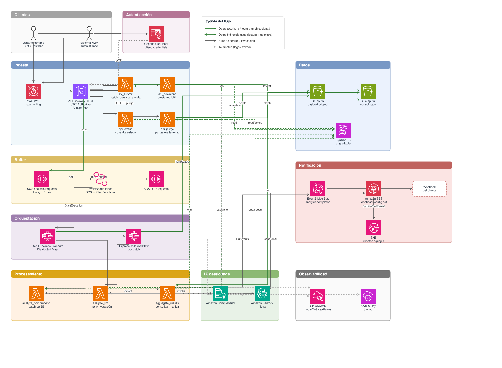
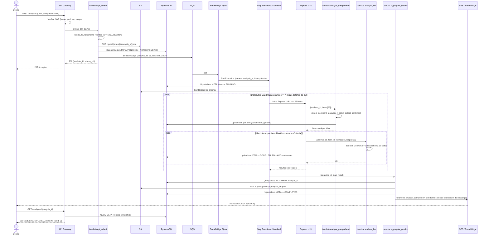
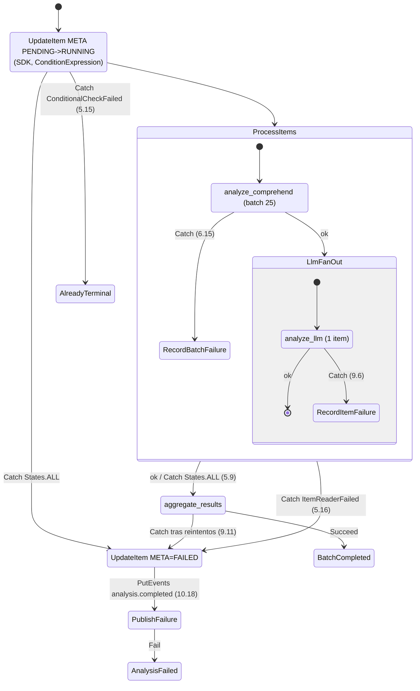
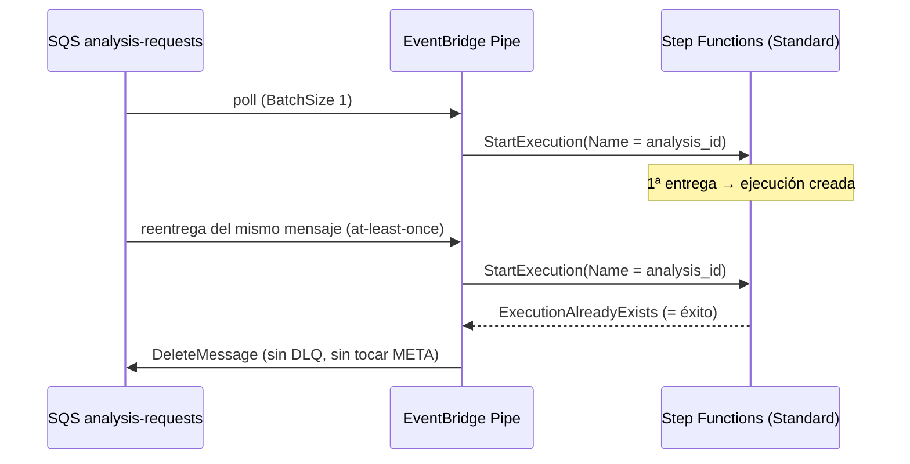
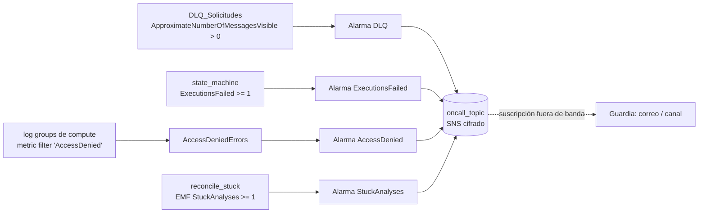
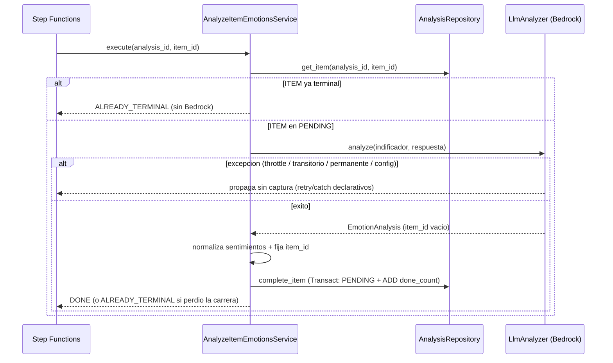

# Arquitectura: serverless-sentiment-pipeline

Este documento resume la arquitectura del pipeline para que un ingeniero que no
escribió el código pueda entender la estructura y los flujos sin leer todo el
fuente. Es la vista operativa del diseño completo, que vive en
[`.kiro/specs/serverless-sentiment-pipeline/design.md`](../.kiro/specs/serverless-sentiment-pipeline/design.md).
Los diagramas de componentes y de secuencia de este documento están tomados de
ese diseño y deben actualizarse cuando la estructura que representan cambie.

Documentos relacionados:

- [`API.md`](./API.md) — contrato de los cinco endpoints de la API REST.
- [`RUNBOOK.md`](./RUNBOOK.md) — runbook operativo: alarmas, sweeper, variables de
  entorno y pruebas de integración/carga.

## Tabla de contenidos

- [1. Resumen del sistema](#1-resumen-del-sistema)
- [2. Estilo arquitectónico](#2-estilo-arquitectónico)
- [3. Diagrama de componentes](#3-diagrama-de-componentes)
- [4. Flujo de datos extremo a extremo](#4-flujo-de-datos-extremo-a-extremo)
- [5. Diagrama de secuencia: camino feliz](#5-diagrama-de-secuencia-camino-feliz)
- [6. Modelo de datos](#6-modelo-de-datos)
- [7. Decisiones estructurales clave](#7-decisiones-estructurales-clave)
- [8. Tecnologías e infraestructura](#8-tecnologías-e-infraestructura)
  - [8.1 Stack `storage`](#81-stack-storage-almacenamiento-y-cifrado-base)
  - [8.2 Stack `notifications`](#82-stack-notifications-notificación-de-fin-de-proceso)
  - [8.3 Stack `auth`](#83-stack-auth-identidad-y-autenticación-m2m)
  - [8.4 Stack `workflow`](#84-stack-workflow-orquestación-por-lote)
  - [8.5 Stack `observability`](#85-stack-observability-operación-alarmas-críticas-y-topic-de-guardia)
  - [8.6 Stack `api`](#86-stack-api-exposición-http)
- [9. Capa de servicios: casos de uso](#9-capa-de-servicios-casos-de-uso)
- [10. Capa de adaptadores, handlers y observabilidad](#10-capa-de-adaptadores-handlers-y-observabilidad)
- [11. Pruebas de integración contra un stack desplegado (`dev`)](#11-pruebas-de-integración-contra-un-stack-desplegado-dev)

## 1. Resumen del sistema

El sistema transforma un análisis de sentimiento sincrónico de un solo ítem en
un **pipeline serverless asíncrono y multi-ítem**. El cliente sube un lote de
respuestas de encuesta (un array JSON), recibe de inmediato un `analysis_id`, y
el lote se procesa en paralelo de forma tolerante a fallos. El estado se consulta
por un endpoint `GET` y el resultado se descarga mediante una URL prefirmada.

## 2. Estilo arquitectónico

Arquitectura **serverless event-driven con capas hexagonales dentro de cada
función**. Cada Lambda tiene tres capas estrictas:

| Capa | Responsabilidad | Puede importar |
|---|---|---|
| `handlers/` | Adaptador de transporte: traduce el evento (API Gateway, SQS, Step Functions) al modelo de dominio y el resultado/error a la respuesta del transporte. Sin lógica de negocio. | `services/`, `domain/` |
| `services/` | Casos de uso. Lógica de negocio pura, dependencias inyectadas por constructor. | `domain/`, puertos (protocolos) |
| `adapters/` | Implementaciones concretas de los puertos: clientes de Comprehend, Bedrock, DynamoDB, S3, SES, EventBridge. | SDK de AWS |

El motivo: la lógica de negocio queda testeable sin AWS, y los clientes de AWS
se instancian **una sola vez por contenedor** (fuera del handler) para reutilizar
conexiones TLS entre invocaciones y reducir el cold start.

## 3. Diagrama de componentes

Diagrama de componentes del sistema, renderizado con **draw.io** usando los
iconos oficiales de servicios de AWS. Fuente editable:
[`diagrams/componentes.drawio`](./diagrams/componentes.drawio) (ábrela en [draw.io](https://app.diagrams.net) o con la extensión
*Draw.io Integration* de VS Code). La imagen de abajo ([`diagrams/componentes.svg`](./diagrams/componentes.svg)) es la exportación
de esa fuente; **ambos archivos deben actualizarse juntos** cuando cambie la
estructura de componentes.



## 4. Flujo de datos extremo a extremo

1. **Ingesta**: `POST /analyses` con `Authorization: Bearer <JWT>` → WAF → API
   Gateway (JWT authorizer) → `api_submit`.
2. **Validación**: `api_submit` valida el array completo contra un JSON Schema
   estricto antes de persistir nada. Rechazo total o aceptación total del lote
   (no parcial), para que el cliente tenga un contrato claro.
3. **Persistencia**: payload canonicalizado → `inputs/{tenant_id}/.../{analysis_id}.json`
   en S3; registro `META` + N registros `ITEM` en DynamoDB en estado `PENDING`
   (escritos con `BatchWriteItem` en tandas de 25).
4. **Encolado**: un único mensaje a SQS con `{analysis_id, tenant_id, s3_key,
   item_count}`. Respuesta `202 Accepted` al cliente con `analysis_id` y la URL
   de estado.
5. **Fan-out**: EventBridge Pipes consume SQS y lanza la ejecución de Step
   Functions (sin código propio). El Distributed Map lee el array desde S3 con
   `ItemReader`, agrupa con `ItemBatcher` en lotes de 25 y lanza workflows
   Express hijos.
6. **Procesamiento concurrente**: cada hijo llama `analyze_comprehend` (un
   `batch_detect_sentiment` para los 25) y luego, con un Map interno,
   `analyze_llm` por ítem. Cada ítem se escribe en DynamoDB en estado `DONE` o
   `FAILED`, y se incrementan los contadores atómicos del `META`.
7. **Agregación**: al terminar el Distributed Map, `aggregate_results` lee todos
   los ítems del lote, escribe el JSON consolidado en `outputs/`, marca el `META`
   como `COMPLETED` / `COMPLETED_WITH_ERRORS` / `FAILED`, y dispara las
   notificaciones.
8. **Consumo**: el cliente hace `GET /analyses/{analysis_id}` (estado +
   contadores) y, cuando es terminal, `GET /analyses/{analysis_id}/download` para
   obtener una URL prefirmada de 15 minutos.
9. **Supresión**: con el scope `sentiment/analyses.purge`, el cliente hace
   `DELETE /analyses/{analysis_id}` sobre un lote terminal propio; `api_purge`
   elimina los ítems, los objetos de S3 (todas sus versiones) y, en último lugar,
   el `META`.

## 5. Diagrama de secuencia: camino feliz

Flujo completo de un lote por el camino feliz, desde la ingesta hasta la consulta
de estado:



El manejo de fallo parcial de un ítem (reintentos declarativos de Step Functions,
`ToleratedFailurePercentage = 100`, DLQ de ítems) está documentado en la sección
3.2 del diseño.

## 6. Modelo de datos

DynamoDB **single-table**: el acceso principal, "dame el lote y todos sus ítems",
es una sola `Query` por `pk`. Dos entidades con relación 1-N jerárquica
(`ANALYSIS_META` y `ANALYSIS_ITEM`), con GSI1 para el listado por tenant y GSI2
sparse para la detección de lotes/ítems no terminales.

```mermaid
erDiagram
    ANALYSIS_META ||--o{ ANALYSIS_ITEM : contiene
    TENANT ||--o{ ANALYSIS_META : posee

    ANALYSIS_META {
        string pk "TENANT#{tenant_id}#ANALYSIS#{analysis_id}"
        string sk "META"
        string status "PENDING|RUNNING|COMPLETED|COMPLETED_WITH_ERRORS|FAILED|EXPIRED"
        number item_count "N total"
        number done_count "contador atomico ADD"
        number failed_count "contador atomico ADD"
        number skipped_count "contador atomico ADD"
        string input_s3_key
        string output_s3_key "null hasta el cierre con consolidacion"
        string execution_arn
        string created_at "ISO8601 UTC"
        string updated_at "ISO8601 UTC"
        string completed_at
        string event_published_at "null hasta publicar analysis.completed"
        number ttl "epoch, created_at + 90d"
        string gsi1pk "TENANT#{tenant_id}"
        string gsi1sk "CREATED#{created_at}#{analysis_id}"
        string gsi2pk "sparse: SWEEP mientras no sea terminal o sin evento"
        string gsi2sk "UPDATED#{updated_at}#{analysis_id}"
    }

    ANALYSIS_ITEM {
        string pk "TENANT#{tenant_id}#ANALYSIS#{analysis_id}"
        string sk "ITEM#{index:05d}"
        string item_id "{analysis_id}#{index:05d}"
        number index "posicion en el array original"
        string indificador
        string respuesta "PII - cifrado en reposo con CMK"
        string status "PENDING|DONE|FAILED|SKIPPED"
        string language_code
        string sentimiento_general "Positivo|Negativo|Neutral|Mixto"
        number sentiment_score_positive
        number sentiment_score_negative
        number sentiment_score_neutral
        number sentiment_score_mixed
        list sentimientos "lista de strings del LLM"
        string explicacion
        string model_id
        string error_code "solo si FAILED"
        number attempt_count
        string processed_at
        number ttl
        string gsi2pk "sparse: STUCK#{analysis_id} solo si PENDING"
        string gsi2sk "CREATED#{created_at}"
    }
```

El layout de S3 particiona por fecha bajo los prefijos `inputs/`, `outputs/` y
`map-results/`. Cifrado en reposo con CMK propia; `respuesta` es PII.

### 6.1 Modelo de dominio en código (`domain/models.py`)

El tipado de las entidades anteriores vive en `backend/src/sentiment/domain/models.py`,
la pieza central de la capa `domain/`. Es **puro**: importable sin `boto3` ni ningún
adaptador (Requirement 17.2), lo que permite probar la lógica de negocio aislada de la
infraestructura.

- **Enums** (`StrEnum`): `AnalysisStatus` (estado del Lote), `ItemStatus` (estado del
  Ítem) y `SentimientoGeneral`, que traduce las etiquetas de Comprehend al español con
  el método total `from_comprehend` (toda etiqueta desconocida o ausente cae en
  `NO_DETERMINADO`, nunca lanza — Requirement 6.3).
- **Conjuntos terminales**: `TERMINAL_ANALYSIS_STATUSES` y `TERMINAL_ITEM_STATUSES`
  (`frozenset`) definen el Estado_Terminal de Lote e Ítem; son la condición de parada
  de la orquestación y la base de la idempotencia de los reintentos.
- **Valores inmutables** (`frozen=True, slots=True`): `SurveyAnswer`, `SentimentScores`
  (con `Decimal`, porque DynamoDB no acepta `float`), `ClassicSentiment` y
  `EmotionAnalysis`.
- **Proyecciones mutables** (`slots=True`): `AnalysisItem` y `AnalysisMeta`. Esta última
  expone `is_terminal` y `progress_ratio` — una fracción acotada a `[0.0, 1.0]`
  calculada como `(done + failed + skipped) / item_count`, que nunca supera `1.0` ni
  divide por cero cuando el Lote no tiene Ítems (Requirement 11.2).

Los puertos (`domain/ports.py`) se documentan al implementarse.

#### 6.1.1 Jerarquía de errores y Catalogo_De_Errores (`domain/errors.py`)

El catálogo de errores vive en `backend/src/sentiment/domain/errors.py`, también
**puro** e importable sin `boto3` (Requirement 17.2). Define la raíz `SentimentError`
y materializa el **Catalogo_De_Errores cerrado** del glosario: todo `error_code` que
el Sistema devuelve a un cliente o registra en un registro ITEM o META proviene de
esta jerarquía, y ninguno fuera de ella.

`SentimentError` expone tres atributos de clase que las subclases redefinen:

- **`error_code: str`** — código del catálogo, seguro para exponer al cliente (por
  defecto `INTERNAL_ERROR`).
- **`http_status: int | None`** — código HTTP cuando el error cruza la frontera de la
  API, o `None` en los errores de procesamiento, que nunca se devuelven por HTTP.
- **`is_transient: bool`** — `True` si la Maquina_De_Estados debe reintentar la tarea
  (clase transitoria del criterio 9.16); `False` en el resto.

El método `to_client_dict(correlation_id)` construye el único payload que ve el
cliente: `{"error_code", "correlation_id"}`, sin el mensaje ni el `detail` interno
(sección 20.2 del diseño, criterio 15.5). El `detail` (contexto como `item_id`) sólo
alimenta logs del lado del servidor.

Hay **dos familias que no se mezclan** (glosario, «Separación de roles»):

- **Familia de API (HTTP)** — cruzan la frontera y se devuelven al cliente:
  - Autenticación: `UnauthenticatedError` (401), `ForbiddenError` (403).
  - Validación (subclases de `ValidationError`, 400 por defecto): `ValidationError`
    (`VALIDATION_FAILED`), `PayloadTooLargeError` (413), `TooManyItemsError`,
    `UnknownIndificadorError`, `ResponseTooLongError`.
  - Control de flujo y recursos: `QuotaExceededError` (429), `NotFoundError` (404),
    `NotReadyError` (409).
- **Familia de procesamiento (interna, `http_status = None`)** — su `error_code` se
  registra en un ITEM o META, nunca por HTTP. La Maquina_De_Estados reintenta o no
  según el **nombre de la clase** (que compara en `ErrorEquals`):
  - **Transitoria (criterio 9.16, `is_transient = True`):**
    `TransientDependencyError` y su subclase `ThrottledError`. Reintentable.
  - **Permanente (criterio 9.17, `is_transient = False`):**
    `PermanentProcessingError` y sus subclases `ComprehendItemFailedError`
    (`COMPREHEND_ITEM_FAILED`), `LlmInputRejectedError` (`LLM_INPUT_REJECTED`),
    `LlmSchemaError` (`LLM_OUTPUT_INVALID`), `TaskInputInvalidError`
    (`TASK_INPUT_INVALID`). Van a `FAILED` en la primera ocurrencia, sin reintentos.
  - **Desenlaces no clasificados** (ni transitorios ni permanentes):
    `ComprehendResultMissingError` (`COMPREHEND_RESULT_MISSING`),
    `InputReadFailedError` (`INPUT_READ_FAILED`), `AggregationError`
    (`AGGREGATION_FAILED`).

Tres valores del catálogo **no son excepciones**:

- `ORPHANED_AFTER_MAP` y `EXECUTION_ABANDONED` son constantes `str` que
  `aggregate_results` y `reconcile_stuck` escriben directamente en el `error_code` de
  un Ítem al cerrarlo como `FAILED` (criterios 10.2 y 10.11–10.13), sin lanzar ni
  capturar una excepción.
- `ALREADY_TERMINAL` es un **valor de resultado** (no un `error_code` ni un fallo):
  lo devuelve `analyze_llm` cuando el Ítem ya estaba en un Estado_Terminal (criterio
  8.2), denotando una invocación idempotente sin trabajo pendiente. No pertenece al
  Catalogo_De_Errores, no se persiste ni se devuelve por HTTP.

### 6.2 Identificadores del dominio (`domain/ids.py`)

Las reglas de nomenclatura de la [sección 7 del diseño](../.kiro/specs/serverless-sentiment-pipeline/design.md)
viven en `backend/src/sentiment/domain/ids.py`, también **puro** e importable sin
`boto3` (Requirement 17.2). Expone tres funciones y las constantes asociadas:

- **`new_analysis_id() -> str`**: genera el `analysis_id` de un Lote como **ULID de 26
  caracteres** en Crockford base32. El ULID combina 48 bits de timestamp en milisegundos
  (lo que lo hace ordenable temporalmente y da un `gsi1sk` naturalmente ordenado) con 80
  bits de aleatoriedad criptográfica. Se genera del lado del servidor a partir del reloj
  y de un CSPRNG, por lo que es independiente de todo dato controlado por el cliente
  (criterios 4.6, 4.7). Es la implementación concreta que los servicios inyectan como
  `id_factory`, lo que permite sustituirla por una fábrica determinista en las pruebas.
- **`make_item_id(analysis_id, index) -> str`**: deriva el `item_id` de forma
  **determinista** como `{analysis_id}#{index:05d}` (criterio 4.5). Al ser función pura de
  `(analysis_id, index)`, el reproceso de un mismo Lote produce los mismos `item_id` y la
  escritura es idempotente sin tabla auxiliar (criterio 8.6; ver decisión 4 en la
  [sección 7](#7-decisiones-estructurales-clave)). El padding a cinco dígitos preserva el
  orden lexicográfico de las sort keys de DynamoDB y soporta hasta 100.000 Ítems por Lote
  (constante `MAX_INDEX`), muy por encima del límite de 1.000 de la ingesta. Valida sus
  entradas y lanza `ValueError` ante un `analysis_id` no-ULID o un `index` fuera de rango.
- **`is_valid_ulid(value) -> bool`**: validación sintáctica **total** (nunca lanza, acepta
  cualquier objeto) de un ULID de 26 caracteres. Delega la comprobación de longitud,
  alfabeto y no-desbordamiento de 128 bits en el decodificador de `python-ulid` y es
  insensible a mayúsculas/minúsculas. La usa la capa de API para tratar un `analysis_id`
  malformado igual que uno inexistente o ajeno (404 idéntico byte a byte, criterio 2.7 y
  Property 6 de aislamiento entre tenants).

### 6.3 Parseo de la salida del Modelo_Bedrock (`domain/llm_parsing.py`)

El parseo del texto crudo que devuelve el Modelo_Bedrock vive en
`backend/src/sentiment/domain/llm_parsing.py`, también **puro** e importable sin `boto3`
(Requirement 17.2); su única dependencia de terceros es `jsonschema`, ya empaquetada en
la Lambda Layer. Es la pieza que materializa el Requirement 7.4–7.7 y 7.13: convierte
cualquier texto del modelo en un `EmotionAnalysis` válido **o** falla con `LlmSchemaError`
(`error_code = LLM_OUTPUT_INVALID`), sin ningún tercer desenlace. La separación de este
parseo del adaptador de Bedrock (`adapters/bedrock_adapter.py`, tarea 6.3) mantiene la
lógica de interpretación testeable sin infraestructura: el adaptador aporta el texto y los
metadatos (`model_id`, tokens), y este módulo decide el resultado.

- **`iter_candidate_objects(raw) -> Iterator[dict]`**: generador perezoso que recorre los
  primeros `MAX_SCAN_CHARS` (100.000) caracteres y, por cada llave de apertura `{` en orden
  creciente de posición, extrae el subtexto con llaves **balanceadas** y lo intenta parsear
  de forma independiente. El recorrido respeta los literales de cadena JSON y sus escapes,
  por lo que distingue correctamente objetos concatenados (`{...}{...}`) y llaves embebidas
  en valores de texto. Se usa un escáner carácter a carácter, **no** una expresión regular
  codiciosa `\{.*\}`, para evitar unir el primer `{` con el último `}` y para no arriesgar
  backtracking catastrófico ante entradas adversas. Es total: nunca lanza; a lo sumo no
  emite candidatos.
- **`extract_json_object(raw) -> dict`**: auxiliar de inspección/pruebas que devuelve el
  primer objeto parseable (tolerando fences ` ```json `, prosa y envoltura en array de un
  elemento), o lanza `LlmSchemaError` si no hay ninguno. El camino de producción no es este,
  sino `parse_llm_output`, que selecciona el primer candidato **conforme al esquema**.
- **`normalize_sentimientos(value) -> tuple[str, ...]`**: aplica la normalización del
  criterio 7.6 — descarta no-cadenas, recorta y pasa a minúsculas, descarta vacíos y los que
  exceden `MAX_SENTIMENTO_LEN` (40 caracteres, más estricto que el `maxLength: 60` del
  esquema), elimina duplicados conservando la primera aparición y retiene a lo sumo
  `MAX_SENTIMIENTOS` (10) valores distintos. Es total: cualquier entrada (incluida una que no
  sea lista) produce una tupla sin lanzar.
- **`parse_llm_output(raw, item_id, *, model_id, input_tokens, output_tokens) -> EmotionAnalysis`**:
  la función **total** del parseo (criterio 7.13). Adopta el primer candidato que valida
  contra el JSON_Schema `llm_output` (criterio 7.4), sin reparar el texto; si ninguno valida,
  lanza `LlmSchemaError` (criterio 7.5). Sobre el objeto adoptado normaliza `sentimientos` y,
  si la lista normalizada queda vacía, fija `explicacion` a la cadena vacía (criterio 7.7).
  Los metadatos de la invocación son argumentos de palabra clave con valores neutros por
  defecto, de modo que la función es pura y testeable sin AWS. Nunca devuelve `None` ni
  propaga ninguna excepción distinta de `LlmSchemaError`. La propiedad universal que la
  cubre es **Property 12 (P12)**, cuya prueba Hypothesis es la tarea 4.3.

## 7. Decisiones estructurales clave

1. **La orquestación es por lote, no por ítem.** Una ejecución de Step Functions
   por `analysis_id`, con un Distributed Map que itera el array desde S3. Esto
   evita las decenas de miles de transiciones de estado (y su costo) que supondría
   una ejecución por ítem, y da manejo nativo de fallo parcial y fin de proceso.
2. **Comprehend y Bedrock viven en Lambdas separadas**, porque sus perfiles de
   latencia, cuotas y política de reintentos son radicalmente distintos (lotes de
   25 documentos en ~200 ms vs. 2-20 s por ítem).
3. **La verdad del estado vive en DynamoDB**, con contadores atómicos en el
   registro del lote. Ninguna notificación es la fuente de verdad; la notificación
   es una optimización sobre un endpoint de estado consultable.
4. **`item_id` determinista** (`{analysis_id}#{index:05d}`) hace que el reproceso
   escriba sobre el mismo registro: idempotencia natural sin tabla auxiliar.

## 8. Tecnologías e infraestructura

- **Lenguaje**: Python 3.12. Lambdas en `arm64`.
- **IaC**: AWS CDK en Python, en `infraestructura/`, con stacks por dominio
  (`auth`, `storage`, `data`, `notifications`, `ingest`, `compute`, `workflow`,
  `api`, `observability`).
- **Cómputo y orquestación**: AWS Lambda, Step Functions (Standard + Express
  Distributed Map), EventBridge Pipes.
- **Datos**: DynamoDB single-table (On-Demand, PITR, TTL, cifrado KMS) y S3
  privado con versionado y cifrado KMS.
- **IA**: Amazon Comprehend (idioma + sentimiento) y Amazon Bedrock (Nova).
- **API y seguridad**: API Gateway REST con autorizador JWT, Cognito
  (`client_credentials`), WAF, Secrets Manager, SSM Parameter Store, CMK de KMS.
- **Notificación**: EventBridge Bus, SES y webhook firmado con HMAC-SHA256.
- **Observabilidad**: CloudWatch Logs/Metrics/Alarms y AWS X-Ray.

### 8.1 Stack `storage` (almacenamiento y cifrado base)

Primer stack con estado del grafo de dependencias (no depende de ningún otro;
todos los demás referencian sus recursos). Implementado en
`infraestructura/stacks/storage_stack.py`. Se despliega con
`termination_protection=True` y sus recursos con `RemovalPolicy.RETAIN`.

Recursos y atributos públicos (tipados con interfaces de CDK para desacoplar a
los consumidores, diseño 14.4.3):

| Atributo | Tipo | Recurso | Garantías |
|---|---|---|---|
| `StorageStack.key` | `kms.IKey` | CMK `alias/{proyecto}-{env}` | Rotación automática anual (`EnableKeyRotation`, periodo 365 días). *Key policy* que delega en IAM y autoriza a CloudWatch Logs a cifrar los *log groups* del proyecto |
| `StorageStack.bucket` | `s3.IBucket` | Bucket `{proyecto}-{env}-analysis-{account_id}` | Acceso público bloqueado por completo; versionado; `SSE-KMS` con la CMK y `BucketKeyEnabled`; política que deniega todo request sin TLS (`aws:SecureTransport=false`); *lifecycle* de 6.5/12.8 |
| `StorageStack.shared_layer` | `lambda_.ILayerVersion` | Lambda Layer `{proyecto}-{env}-deps` | Dependencias de terceros compartidas (`arm64`, Python 3.12) |

**Lifecycle del bucket** (criterios 16.2–16.5 y 12.8): los prefijos `inputs/` y
`outputs/` transicionan a Standard-IA a los 30 días, a Glacier Instant Retrieval
a los 90 días y expiran a los 365 días; `map-results/` expira a los 30 días; en
todo el bucket, las versiones no actuales expiran a los 7 días, se limpian los
marcadores de eliminación huérfanos y se abortan las cargas multiparte
incompletas a los 7 días.

**Lambda Layer de dependencias** (construct `DependenciesLayer` en
`infraestructura/constructs/dependencies_layer.py`, criterio 17.16): empaqueta
`aws-lambda-powertools`, `pydantic`, `jsonschema` y `python-ulid` desde
`backend/requirements.txt` (sin `boto3`/`botocore`, que ya vienen en el runtime).
Se construye con *bundling local* de CDK que ejecuta
`pip install --platform manylinux2014_aarch64 --only-binary=:all:` para obtener
*wheels* de `arm64`, de modo que `cdk synth` no necesita Docker (diseño 14.3). El
*hash* del *asset* se deriva del `requirements.txt`, así la capa solo se
reconstruye cuando cambian las dependencias pineadas.

> La carpeta `infraestructura/constructs/` es un *namespace package* (sin
> `__init__.py`): comparte el espacio de nombres `constructs` con la librería de
> CDK en lugar de ensombrecerla, de modo que `from constructs import Construct` y
> `from constructs.dependencies_layer import DependenciesLayer` conviven.

> Nota de mantenimiento: los diagramas de las secciones 3, 5 y 6 provienen del
> diseño aprobado. Al cambiar la estructura de componentes, el flujo de secuencia
> o el modelo de datos, actualiza aquí el diagrama correspondiente en el mismo
> cambio. El diagrama de componentes tiene además una fuente editable en
> [`diagrams/componentes.drawio`](./diagrams/componentes.drawio) que debe mantenerse
> sincronizada con el bloque Mermaid de la sección 3.

### 8.2 Stack `notifications` (notificación de fin de proceso)

Dominio de notificación push, *backbone* de integración sobre el endpoint de
estado consultable (ninguna notificación es la fuente de verdad; esa vive en la
Dynamo_Table, criterio 13.9). Implementado en
`infraestructura/stacks/notifications_stack.py` (tarea 13.3). Depende de `storage`
(CMK + Layer) y `data` (Dynamo_Table). Es un stack **sin estado** salvo el secreto
HMAC, que se retiene (`RemovalPolicy.RETAIN`) por ser material sensible de larga
vida.

Recursos y atributos públicos (tipados con interfaces de CDK, diseño 14.4.3):

| Atributo | Tipo | Recurso | Garantías |
|---|---|---|---|
| `NotificationsStack.event_bus` | `events.IEventBus` | Bus EventBridge `{proyecto}-{env}-events` | Nombre EXACTO del contrato compartido con `compute` (ver abajo). `aggregate_results` publica aquí el Evento_Finalizacion (`detail-type = analysis.completed`, criterio 13.1) |
| `NotificationsStack.webhook_rule` | `events.Rule` | Regla `{proyecto}-{env}-analysis-completed-webhook` | *Match* por `detail-type = "analysis.completed"` sobre el bus; objetivo: la Lambda `notify_webhook` (criterio 13.1) |
| `NotificationsStack.notify_webhook` | `lambda_.IFunction` | Lambda `notify_webhook` (`BackendFunction`) | `arm64`, rol propio, *log group* cifrado 30 días, X-Ray. Destino asíncrono `OnFailure` → DLQ_Notificaciones (criterios 9.9, 9.10) |
| `NotificationsStack.webhook_secret` | `secretsmanager.ISecret` | Secreto `{proyecto}-{env}-webhook-hmac` | Valor **generado** por Secrets_Manager (nunca *hardcodeado*, criterio 15.5), cifrado con la CMK. Retenido ante *destroy* |
| `NotificationsStack.notifications_dlq` | `sqs.IQueue` | Cola `{proyecto}-{env}-notifications-dlq` | `SSE-KMS` con la CMK, retención 14 días (criterio 9.10), `enforce_ssl` |
| `NotificationsStack.ses_identity` | `ses.EmailIdentity` | Identidad SES verificada (remitente) | Dirección remitente desde `config.ses_sender_email` (marcador no secreto por entorno, nunca una dirección real *hardcodeada*). Asociada al *configuration set* para heredar el seguimiento de rebotes/quejas (criterio 13.4) |
| `NotificationsStack.ses_configuration_set` | `ses.IConfigurationSet` | *Configuration set* `{proyecto}-{env}-email-events` | Destino de eventos que captura EXACTAMENTE rebote (`bounce`) y queja (`complaint`) hacia el topic SNS; TLS requerido; métricas de reputación activas (criterio 13.10). El backend `notify_email` lo pasa en cada `SendEmail` vía `SES_CONFIGURATION_SET` |
| `NotificationsStack.ses_bounce_topic` | `sns.ITopic` | Topic `{proyecto}-{env}-ses-bounces-complaints` | Destino de eventos del *configuration set*; `SSE-KMS` con la CMK (criterio 15.6), `enforce_ssl`. Registros durables/consumibles de rebotes y quejas |

**Acoplamiento del nombre del Bus_Eventos.** El literal del nombre
(`{proyecto}-{env}-events`) es un contrato compartido con `compute`: ese stack
concede `events:PutEvents` y publica la variable `EVENT_BUS_NAME` de
`aggregate_results` derivándolo de la misma convención. Para que ambos lados no se
desincronicen, la convención vive en una **única fuente de verdad**,
`infraestructura/stacks/naming.py` (`event_bus_name(config)`), que ambos stacks
importan en lugar de duplicar el literal. Si el nombre no coincidiera, la política
IAM y la variable de entorno del publicador apuntarían a un bus inexistente.

**Mínimo privilegio de `notify_webhook`** (criterios 15.10/15.11):
`secretsmanager:GetSecretValue`/`DescribeSecret` **solo** sobre el ARN del secreto
HMAC concreto (nunca comodín ni acciones de mutación); `dynamodb:GetItem`/`Query`
sobre la Dynamo_Table para resolver el perfil del Tenant (URL de webhook +
`secret_id`); y `sqs:SendMessage` sobre la DLQ concreta, concedido por el propio
destino `OnFailure`. El `kms:Decrypt` del secreto se concede en la política de
**principal** del rol (`key.grant_decrypt`), no en la *key policy*, para evitar un
ciclo de dependencia `storage -> notifications`. El valor del secreto no se expone
en *outputs* ni en logs.

**SES: identidad verificada y seguimiento de rebotes/quejas** (tarea 13.4,
criterios 13.4 y 13.10). El canal de correo exige dos piezas de infraestructura en
este stack:

- **Identidad verificada** (`ses_identity`): SES solo envía desde identidades
  verificadas. El remitente proviene de `config.ses_sender_email`, un valor **no
  secreto por entorno** (marcador tipo `no-reply@sentiment.example.com` que el
  operador sustituye por el buzón real verificado fuera de banda); nunca se
  *hardcodea* una dirección real en el código (steering de seguridad). La identidad
  se asocia al *configuration set* para que todo correo herede el seguimiento de
  rebotes/quejas por defecto.
- **Configuration set dedicado** (`ses_configuration_set`): captura los eventos de
  rebote y queja y los publica en un topic SNS (`ses_bounce_topic`). Gestionar
  estos eventos es lo que evita que SES suspenda la cuenta por reputación; el
  criterio 13.10 exige registrarlos en un *configuration set* dedicado. Se eligió
  un **topic SNS** como destino (frente a métricas de solo CloudWatch) porque da
  registros durables y consumibles: un proceso de operaciones puede suscribirse
  para reaccionar (p. ej. suprimir una dirección) o alarmar sobre la tasa de
  rebote. El topic se cifra con la CMK (criterio 15.6) y deniega el acceso sin TLS.

La Lambda `notify_email` (handler `sentiment.handlers.notify_email.handler`, tarea
9.5) **no** forma parte de la composición de este stack: el diseño (sección
14.4.2) lista para `notifications` únicamente `notify_webhook`. El correo lee el
nombre del *configuration set* por `SES_CONFIGURATION_SET` y la dirección
remitente por `SES_FROM_ADDRESS` cuando se cablee en una tarea posterior. El
cuerpo del correo contiene un **enlace** a `GET /v1/analyses/{analysis_id}/download`
(que re-autentica al cliente), nunca una Presigned_URL ni PII (criterios 13.3,
13.4). SES es **mejor esfuerzo**: un fallo de envío nunca altera el estado terminal
del Lote en la Dynamo_Table (criterios 13.8, 13.9).

### 8.3 Stack `auth` (identidad y autenticación M2M)

Dominio de identidad autoritativa: emisor de los Access_Tokens que el autorizador
JWT nativo de la `api` (tarea 13.2) verifica, y origen de la autorización por
*scope*. Implementado en `infraestructura/stacks/auth_stack.py` (tarea 13.1). **No
tiene dependencias** de otros stacks (es el stack raíz del grafo junto a `storage`,
diseño 14.4.2). Es un stack **con estado**: se despliega con
`termination_protection=True` y el User Pool y los secretos se retienen
(`RemovalPolicy.RETAIN`), porque perder el pool invalidaría todos los
Access_Tokens y los app clients en circulación.

Recursos y atributos públicos (tipados con interfaces de CDK, diseño 14.4.3), que
el `api_stack` consume por *props* sin redeclarar los *scopes*:

| Atributo | Tipo | Recurso | Garantías |
|---|---|---|---|
| `AuthStack.user_pool` | `cognito.IUserPool` | User Pool `{proyecto}-{env}-users` | Atributo personalizado inmutable `custom:tenant_id` (criterios 1.9/2.1); sin auto-registro (consumidores M2M, no usuarios finales); retenido ante *destroy* |
| `AuthStack.user_pool_domain` | `cognito.UserPoolDomain` | Dominio hospedado prefijo `{proyecto}-{env}-auth` | Expone el *endpoint* del token (`/oauth2/token`) del flujo `client_credentials` |
| `AuthStack.resource_server` | `cognito.IUserPoolResourceServer` | Resource Server `sentiment` | Declara **exactamente** los tres *scopes* `analyses.write`/`analyses.read`/`analyses.purge` (criterios 1.6/1.7/19.1) |
| `AuthStack.scope_write` / `scope_read` / `scope_purge` | `cognito.OAuthScope` | *Scopes* `sentiment/analyses.{write,read,purge}` | Exportados para que la `api` los cablee por ruta sin redeclararlos |
| `AuthStack.m2m_client` | `cognito.IUserPoolClient` | App client `{proyecto}-{env}-m2m` | `client_credentials` con *client secret*; *scopes* write+read; Access_Token ≤ 3.600 s (criterio 1.8); revocación de token activa; sin flujos interactivos |
| `AuthStack.purge_client` | `cognito.IUserPoolClient` | App client `{proyecto}-{env}-purge` | **Dedicado a la Purga** con **solo** el *scope* `analyses.purge` (mínimo privilegio, criterio 15.11): el compromiso de la credencial de lectura/escritura no habilita el borrado |
| `AuthStack.m2m_secret` / `purge_secret` | `secretsmanager.ISecret` | Secretos `{proyecto}-{env}-{m2m,purge}-client-secret` | Valor **generado** por Secrets_Manager (nunca *hardcodeado*, criterios 17.20/15.5); **rotación automática a 90 días** (criterio 1.13); retenidos ante *destroy* |

**Autenticación M2M (decisión D6, criterios 1.8/1.13).** Los Sistemas_M2M obtienen
su Access_Token con el flujo OAuth2 `client_credentials` contra el *endpoint* del
dominio hospedado, restringido a los *scopes* concedidos a su app client. Ningún
app client habilita flujos interactivos (`authorization_code`/`implicit`): solo
`client_credentials`. El token caduca en 3.600 s como máximo.

**Separación de privilegios de la Purga.** El *scope* destructivo `analyses.purge`
vive en un app client **separado** del general (write+read). Así, la credencial que
envía y lee Lotes no puede purgar, y la de purga no puede enviar ni leer: el radio
de impacto de una credencial comprometida queda acotado.

**Rotación del `client_secret` (criterio 1.13, construct
`CognitoClientSecretRotation` en `infraestructura/constructs/secret_rotation.py`).**
Secrets Manager no sabe rotar por sí mismo el *client secret* de un app client de
Cognito (las rotaciones hospedadas son específicas de motores de base de datos),
así que cada secreto tiene una **Lambda de rotación dedicada** que implementa el
contrato de cuatro pasos (`createSecret` → `setSecret` → `testSecret` →
`finishSecret`), programada cada 90 días. La Lambda es código de infraestructura
(empaquetado en línea, sin dependencias de terceros salvo `boto3`) y **genera** el
nuevo valor localmente con el módulo `secrets`, de modo que todas sus acciones de
Secrets Manager que admiten ARN quedan acotadas al secreto concreto; su rol también
está acotado a `cognito-idp:{Describe,Update}UserPoolClient` sobre el ARN de este
User Pool (criterios 15.10/15.11/17.8). El valor del secreto nunca se registra ni
se expone en *outputs*.

> El `api_stack` (tarea 13.2) depende de este stack y consume `user_pool`,
> `resource_server`, los tres `scope_*` y los app clients para configurar su
> autorizador JWT nativo y la validación de *scope* por ruta.

### 8.4 Stack `workflow` (orquestación por Lote)

Dominio de orquestación: una única ejecución de Step Functions por `analysis_id`
con fan-out interno por Ítem. Implementado en
`infraestructura/stacks/workflow_stack.py`. La **tarea 12.3** construye la
Maquina_De_Estados (lo que se describe aquí); la **tarea 12.4** añade, sobre el
mismo stack, el EventBridge Pipe (cola → `StartExecution`) y la Lambda
`reconcile_stuck` con su regla de EventBridge Scheduler (ver §8.4.1). Depende de
`storage` (CMK + bucket + Layer), `data` (tabla), `ingest` (cola), `notifications`
(Bus_Eventos) y `compute` (las tres Lambdas de los `Task`). Es un stack **sin
estado**: la fuente de verdad es DynamoDB, no la ejecución.

**Topología de la máquina (diseño 17).** El padre es de tipo **Standard** (el
Distributed Map solo existe en Standard y un Lote puede durar horas, por encima
del techo de 5 min de Express) con `TimeoutSeconds = 10800` (criterio 5.12):



| Estado | Integración | Puntos clave |
|---|---|---|
| `MarkRunning` | SDK `dynamodb:updateItem` | `status PENDING→RUNNING` + `execution_arn`, `ConditionExpression: #st = :pending`. Si falla la condición → `AlreadyTerminal` (`Succeed`), el Lote ya era terminal (criterio 5.15) |
| `ProcessItems` | `Map` DISTRIBUTED, hijos EXPRESS | `ItemReader` JSON de S3 (hasta 1.000, criterio 5.3), `ItemBatcher` de 25 (5.4), `MaxConcurrency` 4 (5.5, por `EnvConfig`), `ToleratedFailurePercentage` 100 (5.10), `ResultWriter` a `map-results/` (5.13). `LlmFanOut` interno `MaxConcurrency` 5 (5.6) |
| `Aggregate` | `lambda:invoke` → `aggregate_results` | Siempre corre al terminar el Map (5.9); timeout 300 s |
| `MarkFailed` | SDK `dynamodb:updateItem` + `events:putEvents` + `Fail` | Cierra en `FAILED` y publica el Evento_Finalizacion (`detail-type = analysis.completed`, `event_id = {analysis_id}:FAILED`) **antes** de terminar (criterios 10.17/10.18/10.20) |

**Reintentos declarativos (criterios 9.1–9.4, 9.11).** Toda la repetición vive en
la máquina, no en el código. Cada `Task` de Lambda desactiva el `Retry` que
`LambdaInvoke` inyecta por defecto (`retry_on_service_exceptions=False`) para que
la política sea **exactamente** la del diseño y **solo** cubra condiciones
transitorias (criterio 9.16); las permanentes (criterio 9.17) caen directas al
`Catch` en su primera ocurrencia (criterio 9.4). Todos usan `BackoffRate = 2.0` y
jitter completo (`FULL`):

| Tarea | Reintentos | Base | Techo |
|---|---|---|---|
| `DeepAnalysis` (analyze_llm) | 6 | 2 s | 60 s |
| `ClassicSentiment` (analyze_comprehend) | 5 | 2 s | 30 s |
| `Aggregate` (aggregate_results) | 3 | 5 s | 30 s |

El conjunto de errores reintentables es `TransientDependencyError`,
`ThrottledError`, `States.Timeout`, `Lambda.TooManyRequestsException`,
`Lambda.ServiceException`, `Lambda.SdkClientException`: las clases de excepción
que las Lambdas de procesamiento propagan por nombre (ver §10.4) más los errores de
plataforma de timeout/servicio de la invocación.

**Seguridad y observabilidad.** El rol de ejecución de la máquina lo genera CDK con
mínimo privilegio sobre ARN concretos (criterios 15.10/15.11): `UpdateItem` sobre
la tabla, `s3` sobre el bucket del `ItemReader`/`ResultWriter`, `InvokeFunction`
sobre las tres Lambdas, `events:PutEvents` sobre el Bus_Eventos concreto (referencia
directa a `NotificationsStack.event_bus`, sin acoplar por nombre) y
`StartExecution` sobre el workflow hijo del Distributed Map. Ninguna acción de
datos usa `Resource: "*"` (verificado por `tests/test_iam_policies.py`). La máquina
emite trazas (X-Ray) y vuelca sus logs a un log group propio cifrado con la CMK del
proyecto (criterio 15.6), con `IncludeExecutionData = False` como defensa en
profundidad anti-PII (criterios 5.11/15.3).

> El estado `ProcessItems` propaga **solo** identificadores y claves de objeto
> (`analysis_id`, `tenant_id`, `item_id`/`index`, `correlation_id`), nunca el texto
> de `respuesta` ni de `explicacion` (criterio 5.11). `self.state_machine` se expone
> tipado para que el Pipe + sweeper (§8.4.1) y el `observability_stack` lo
> referencien sin acoplarse a la construcción interna.

#### 8.4.1 Arranque idempotente (Pipe) y terminación garantizada (sweeper) — tarea 12.4

Dos recursos cierran el lazo de la orquestación sobre la misma máquina, sin
cambiar la firma del stack.

**EventBridge Pipe `requests_pipe` (Cola_Solicitudes → `StartExecution`).** Es el
fan-out **sin código** del diseño: su *source* es la Cola_Solicitudes de `ingest`
y su *target* es la Maquina_De_Estados. Por cada mensaje inicia **exactamente una**
ejecución (criterio 5.1) cuyo **nombre de ejecución es el `analysis_id`** del
mensaje —fijado con la clave reservada `Name` del `InputTemplate`, resuelta desde
`<$.body.analysis_id>`—. Esa es la **idempotencia de nivel 1** (criterios
5.14/8.1): como SQS es *at-least-once*, la segunda entrega del mismo mensaje lanza
una `StartExecution` con un nombre ya usado, que falla con `ExecutionAlreadyExists`;
Pipes lo trata como entrega exitosa, **borra** el mensaje y **no** lo traslada a la
DLQ ni toca el META (criterio 5.14). Por eso el Pipe **no** define DLQ propia. El
`InputTemplate` del target propaga al estado inicial solo `analysis_id`,
`tenant_id`, `correlation_id` e `input_s3_key` (el puntero al payload que leerá el
`ItemReader`), nunca el texto de `respuesta` (criterio 5.11). El rol del Pipe recibe
mínimo privilegio sobre ARN concretos (criterios 15.10/15.11): consumo de la cola
concreta (`ReceiveMessage`/`DeleteMessage`/`GetQueueAttributes` + `kms:Decrypt` de la
CMK) y `states:StartExecution` sobre la máquina concreta.



**Lambda `reconcile_stuck` (sweeper) + EventBridge Scheduler.** El *sweeper*
(handler `sentiment.handlers.reconcile_stuck.lambda_handler`, tarea 9.3) convierte
la "terminación garantizada" en una propiedad verificable: una regla de
**EventBridge Scheduler** lo dispara cada **15 minutos** (`rate(15 minutes)`,
ventana de flexibilidad `OFF`, criterio 10.10), de modo que todo Lote atascado o
terminal-sin-evento se evalúe como máximo 15 min después de quedar en esa
situación. Vive en **este** stack —y no en `compute`— porque necesita el **nombre
de la Maquina_De_Estados** para derivar el ARN determinista de las ejecuciones que
inspecciona con `DescribeExecution` (el nombre de la ejecución *es* el
`analysis_id`, diseño 10.6); ubicarlo aquí evita un ciclo `compute` ↔ `workflow`.
Se construye con el molde `BackendFunction` (`arm64`, rol propio, log group cifrado
30 días, X-Ray, Layer + CMK de `storage`), igual que las Lambdas de `compute`.

Mínimo privilegio del rol del sweeper (criterios 15.10/15.11), todo sobre ARN
concretos:

| Permiso | Recurso | Para qué |
|---|---|---|
| `states:DescribeExecution` / `ListExecutions` | `execution:{nombre_sm}:*` | Distinguir un Lote abandonado de uno en curso por su `analysis_id` (diseño 10.6) |
| DynamoDB `GetItem`/`Query`/`UpdateItem`/`PutItem`/`ConditionCheckItem` | tabla **+** `.../index/*` (GSI2 sparse de candidatos `SWEEP`) | Listar candidatos y cerrar los Lotes atascados como `EXPIRED` reconciliando contadores (criterios 10.11/10.14/8.11) |
| `events:PutEvents` | Bus_Eventos concreto (`NotificationsStack.event_bus`) | Publicar el Evento_Finalizacion de los Lotes que cierra o que estaban terminales sin evento (criterios 10.14/10.19) |

La regla del Scheduler usa un rol propio que concede **solo**
`lambda:InvokeFunction` sobre la función del sweeper (ARN concreto). La invariante
`stuck_threshold_seconds ≥ max_receive_count × visibility_timeout + margen`
(validada en `EnvConfig.__post_init__`, criterio 10.12) garantiza que el sweeper
nunca expire un Lote `PENDING` que la cola todavía puede reentregar.

> Verificado por `tests/test_workflow_pipe_and_sweeper.py`: Pipe con source=cola,
> target=máquina, `Name = <$.body.analysis_id>`, Input sin PII y sin DLQ; Lambda
> `reconcile_stuck` con su handler y `STATE_MACHINE_NAME`; regla de Scheduler de 15
> min; y mínimo privilegio IAM (sin `Resource: "*"` en acciones de `states`/datos).

### 8.5 Stack `observability` (operación: alarmas críticas y topic de guardia)

Último stack del grafo de dependencias (depende de `workflow`, `api` y `compute`):
no crea datos de negocio, solo **lee** nombres y ARN de los stacks anteriores para
construir las dimensiones de sus métricas y las fuentes de sus alarmas (diseño
14.4.2). La tarea 13.5 implementa el **topic SNS de guardia** y las **cuatro
alarmas críticas** del catálogo de alarmas (criterios 14.7, 14.8, 14.9, 14.14); la
tarea 13.6 (§8.5.1) extiende el stack con el **panel de CloudWatch**, las **alarmas
no críticas** (alta/media) y el **presupuesto diario**, reutilizando el mismo topic
de guardia.

| Atributo | Tipo | Recurso | Garantías |
|---|---|---|---|
| `ObservabilityStack.oncall_topic` | `sns.ITopic` | Topic `{proyecto}-{env}-oncall-critical` | Cifrado en reposo con la clave gestionada de SNS (`alias/aws/sns`); **sin** suscripción *hardcodeada* (el endpoint de guardia se conecta fuera de banda, criterio 17.20) |
| `ObservabilityStack.dlq_requests_alarm` | `cloudwatch.Alarm` | Alarma DLQ_Solicitudes | `ApproximateNumberOfMessagesVisible` (`Maximum`, 5 min) > 0 sobre la DLQ de `ingest`; crítica (criterio 14.7) |
| `ObservabilityStack.executions_failed_alarm` | `cloudwatch.Alarm` | Alarma Step Functions | `ExecutionsFailed` (`Sum`, 5 min) ≥ 1 sobre `workflow.state_machine`; crítica (criterio 14.8) |
| `ObservabilityStack.access_denied_alarm` | `cloudwatch.Alarm` | Alarma `AccessDenied` | *Metric filter* sobre los log groups de las tres Lambdas de `compute` → métrica custom `AccessDeniedErrors` (namespace `SentimentPipeline`); alarma ≥ 1; crítica (criterio 14.9) |
| `ObservabilityStack.stuck_analyses_alarm` | `cloudwatch.Alarm` | Alarma lotes atascados | Métrica custom EMF `StuckAnalyses` (`Sum`, 5 min) ≥ 1 del sweeper; crítica (criterios 14.9/10.15) |

**Mecánica de cada alarma.** Las cuatro usan `GreaterThanThreshold` con umbral `0`
(disparan con ≥ 1), un único periodo de evaluación de 5 minutos y
`TreatMissingData = NOT_BREACHING` (una métrica sin muestras no es un incidente).
Todas conectan su **acción de alarma y de vuelta a OK** al `oncall_topic` (criterio
14.14), de modo que guardia reciba tanto la apertura como el cierre del incidente.

**Métricas custom: contrato con el backend.** Las alarmas de `AccessDenied` y de
lotes atascados leen métricas del namespace `SentimentPipeline`, el mismo que
emite `backend/src/sentiment/observability/metrics.py`. `StuckAnalyses` la publica
el sweeper `reconcile_stuck` (incluso en 0, criterio 10.15); `AccessDeniedErrors`
la deriva un *metric filter* de CloudWatch Logs a partir del término `AccessDenied`
en el log de cualquier Lambda de procesamiento. Un `AccessDenied` es un **defecto
de despliegue** (una política IAM mal cableada), no un error de datos, de ahí su
severidad crítica.

**Cifrado del topic.** El `observability_stack` **no** recibe la CMK del proyecto
entre sus *props* (su firma es `workflow`/`api`/`compute`), y alcanzarla a través de
un stack dependiente rompería el encapsulamiento del grafo. Como las notificaciones
de alarma no transportan PII (solo nombres de métrica, umbrales e identificadores
de recurso), el topic se cifra con la clave gestionada de SNS, suficiente para el
cifrado en reposo de las notificaciones; la CMK del proyecto sigue cifrando los
datos de negocio (bucket, tabla, colas y log groups).



> Las cuatro alarmas y el topic se exponen como atributos públicos tipados para que
> la tarea 13.6 extienda el stack (panel, alarmas no críticas y presupuesto) sin
> conflicto, y para que `tests/test_observability.py` afirme sobre el template
> sintetizado. `tests/test_iam_policies.py` incluye este stack en su red de
> seguridad de "ninguna acción de datos sobre `Resource: '*'`".

#### 8.5.1 Panel, alarmas no críticas y presupuesto (tarea 13.6)

La tarea 13.6 extiende el stack de forma **puramente aditiva** (sin tocar la firma
`workflow`/`api`/`compute` de `__init__`) con el resto del [catálogo de alarmas
13.2](../.kiro/specs/serverless-sentiment-pipeline/design.md) y el panel de
operación. Todas las alarmas no críticas reutilizan el `oncall_topic` de 13.5: el
diseño define un único punto de notificación operativa, lo que evita dispersar la
suscripción fuera de banda en varios endpoints.

| Atributo | Severidad | Métrica / umbral | Criterio |
|---|---|---|---|
| `lambda_error_rate_alarms` (una por Lambda del camino crítico) | Alta | `Errors / Invocations` (`MathExpression`, 5 min) > 5 % | 14.10 |
| `bedrock_throttles_alarm` | Alta | EMF `BedrockThrottles` (`Sum`, 5 min) > 50 | 13.2 |
| `requests_age_alarm` | Alta | `ApproximateAgeOfOldestMessage` de la Cola_Solicitudes (`Maximum`, 5 min) > 300 s | 13.2 / 10.6.1 |
| `ses_bounce_rate_alarm` | Alta | `AWS/SES` `Reputation.BounceRate` (nivel de cuenta) > 5 % | 13.2 |
| `items_failed_alarm` | Media | EMF `ItemsFailed` (`Sum`, 5 min) > umbral absoluto | 14.11 (aprox.) |
| `lambda_throttled_alarms` (una por Lambda del camino crítico) | Media | `Throttles` (`Sum`, 5 min) ≥ 1 | 13.2 |
| `api_submit_latency_alarm` | Media | `api_submit` `Duration` p99 > 5 s (5000 ms) | 13.2 |
| `daily_budget` | Alta | AWS Budget `COST`/`DAILY` ≥ 100 % del límite (`ACTUAL`) | 14.12 |

**Camino crítico observado.** Las alarmas de tasa de error (14.10) y de *throttling*
cubren las **cuatro** Lambdas cuya degradación afecta directamente al ciclo de vida
de un Lote: las tres de `compute` (`analyze_comprehend`, `analyze_llm`,
`aggregate_results`) y la `api_submit` de admisión. `api_status`/`download`/`purge`
quedan fuera para no añadir ruido al panel ni a la notificación de guardia.

**Panel de CloudWatch (`dashboard`, criterio 14.13).** Un único *dashboard*
`{proyecto}-{env}-pipeline` agrupa las métricas de las tres fases en filas:
*ingesta* (profundidad y antigüedad de la Cola_Solicitudes, p99 de `api_submit`),
*procesamiento* (`ItemsProcessed` vs. `ItemsFailed`, `BedrockThrottles`, tokens
`BedrockInputTokens`/`BedrockOutputTokens`, y errores/throttles de las Lambdas) y
*salud terminal* (`StuckAnalyses`, `ExecutionsFailed`, `Reputation.BounceRate`).
Las métricas de negocio las **produce** el backend en EMF (criterio 14.6); el panel
solo las referencia por namespace `SentimentPipeline` + nombre (contrato observable
duplicado como constantes locales, igual que las alarmas de 13.5).

**Presupuesto diario (`daily_budget`, criterio 14.12).** Un `AWS::Budgets::Budget`
de tipo `COST` y unidad `DAILY` notifica al `oncall_topic` cuando el gasto **real**
(`ACTUAL`) alcanza el 100 % del límite. Para que el servicio pueda publicar en el
topic cifrado se añade a su *resource policy* una sentencia `SNS:Publish` acotada al
principal `budgets.amazonaws.com`, al ARN del propio topic y a la cuenta del stack
(`aws:SourceAccount`): mínimo privilegio, sin comodines ni cuentas de terceros. El
importe es un **marcador de proyecto** (100 USD); el presupuesto real por entorno se
ajusta fuera de banda para no exponer datos financieros en el Repositorio (steering
de seguridad). Es la red de seguridad frente a un gasto desbocado de Bedrock.

**Trazas X-Ray (criterio 14.5).** No hay recurso de X-Ray a nivel de este stack: el
*tracing* distribuido se habilita aguas arriba —cada Lambda sale de
`BackendFunction` con `Tracing.ACTIVE` y la Maquina_De_Estados con
`tracing_enabled=True`—. El diseño no pide una regla de muestreo, así que el stack
solo verifica (guarda defensiva `_assert_tracing_enabled_upstream`) que las Lambdas
del camino crítico conserven su configuración de trazas.

**Desviación documentada (criterio 14.11).** El criterio liga el umbral de Ítems
fallidos al **5 % del `item_count` de cada Lote**. Ese porcentaje es *por Lote* y
depende de un dato (`item_count`) que CloudWatch no conoce al evaluar una métrica
agregada por ventana temporal: no hay forma genérica de expresarlo como umbral de
alarma. El cómputo exacto corresponde al backend (el agregador conoce el
`item_count` y los fallos de su Lote); aquí se aproxima con un **umbral absoluto por
ventana** que capta un repunte anómalo de fallos a nivel de Sistema, que es lo
máximo que esta capa puede garantizar sin el contexto del Lote.

### 8.6 Stack `api` (exposición HTTP)

Dominio de exposición: la frontera pública del Sistema. Implementado en
`infraestructura/stacks/api_stack.py` (tarea 13.2). Depende de `auth` (User Pool y
*scopes*), `storage` (CMK, bucket, Layer), `data` (tabla), `ingest`
(Cola_Solicitudes) y `notifications` (Bus_Eventos). Es un stack **sin estado**: la
API, el WAF, el Usage_Plan y las Lambdas se recrean sin pérdida de datos de negocio
(la verdad vive en la Dynamo_Table).

Recursos:

- **API Gateway REST** con integración *proxy* Lambda y cinco rutas sobre
  `/v1/analyses` (diseño 18.3):

  | Método | Ruta | Lambda | Scope exigido |
  |---|---|---|---|
  | `POST` | `/v1/analyses` | `api_submit` | `sentiment/analyses.write` |
  | `GET` | `/v1/analyses` | `api_status` | `sentiment/analyses.read` |
  | `GET` | `/v1/analyses/{analysis_id}` | `api_status` | `sentiment/analyses.read` |
  | `GET` | `/v1/analyses/{analysis_id}/download` | `api_download` | `sentiment/analyses.read` |
  | `DELETE` | `/v1/analyses/{analysis_id}` | `api_purge` | `sentiment/analyses.purge` |

- **Autorizador JWT nativo de Cognito** (`CognitoUserPoolsAuthorizer`) cableado al
  `user_pool` del `auth_stack`. API Gateway valida la firma (contra el JWKS del
  pool), `iss`, `aud`/`client_id` (los app clients) y `exp` **antes** de invocar
  ninguna Lambda (criterios 1.1-1.5), sin código de autorizador propio. El **scope
  por ruta** (criterios 1.6, 1.7, 19.2) se declara con `authorization_scopes`,
  reutilizando los `scope_write`/`scope_read`/`scope_purge` que expone el `auth`.
  Un fallo de autorización produce 401/403 **genéricos**, sin revelar qué claim,
  scope o firma falló (criterio 1.17).

- **WAF Web ACL** (`REGIONAL`) asociada al *stage*, con tres grupos de reglas
  gestionadas de AWS (`CommonRuleSet`, `KnownBadInputs`, `AmazonIpReputationList`)
  y una regla de **rate limiting** por IP de 2.000 peticiones / 5 min
  (criterio 15.12). El modo (`COUNT`/`BLOCK`) lo fija `config.waf_mode`: `dev` y
  `stage`/`prod` observan y bloquean según el entorno.

- **Usage_Plan** con *throttling* de 10 rps en ráfaga y cuota de 1.000 envíos/día
  (criterio 15.13), más una API_Key asociada. La API_Key **mide y limita**, no
  autentica ni deriva el `tenant_id` (criterio 1.12): esa identidad la aporta el
  JWT.

- **CORS** restringido a `config.cors_origins` por entorno; nunca `*` sobre datos
  sensibles (criterio 15.9 / steering de seguridad). TLS 1.2 mínimo queda
  centralizado para el *security policy* del dominio personalizado cuando se añada
  (criterio 15.15; v1 no despliega dominio).

- **Cuatro Lambdas de API** (`BackendFunction`: `arm64`, rol propio, *log group*
  cifrado 30 días, X-Ray) con concurrencia reservada **20 / 30 / 10 / 2** para
  `api_submit` / `api_status` / `api_download` / `api_purge` (criterios
  18.10-18.12; la purga baja por ser destructiva y poco frecuente).

**Aislamiento multi-tenant por IAM (diseño 12.2 / 12.2.1).** `api_status`,
`api_download` y `api_purge` no acceden a los datos con su rol de ejecución: asumen
un `TenantDataRole` etiquetando la sesión con el `tenant_id` del claim verificado
(y el `analysis_id` de la ruta, en la purga). Sus políticas usan
`${aws:PrincipalTag/tenant_id}` con `dynamodb:LeadingKeys` y prefijos de S3
(`outputs/{tenant_id}/*`, `inputs/{tenant_id}/*`, `map-results/{analysis_id}/*`),
de modo que IAM deniega estructuralmente cualquier lectura o borrado fuera del
Tenant (criterios 2.5, 2.6, 19.12). `api_purge` es la única Lambda con permisos de
borrado. `api_submit` conserva en v1 un rol sin *session tags* (escribe en
`inputs/{tenant_id}/` con el prefijo derivado del claim y encola el Lote). Ninguna
política concede acciones de datos sobre `Resource: "*"` (criterios 15.11 / 17.8).

> **Verificación**: `tests/test_api.py` afirma sobre el template sintetizado el
> autorizador Cognito, el scope por ruta, el WAF con rate limiting, el Usage_Plan,
> el CORS por entorno y las cuatro concurrencias reservadas. `tests/_harness.py`
> expone `synth_api_template`, incluido en la red de seguridad de
> `tests/test_iam_policies.py` ("ninguna acción de datos sobre `Resource: '*'`").

## 9. Capa de servicios: casos de uso

El paquete `backend/src/sentiment/services/` contiene los **casos de uso**: lógica
de negocio pura con los puertos (`domain/ports.py`) inyectados por constructor. No
importan `boto3` ni adaptadores, por lo que se prueban con dobles en memoria.

### 9.1 `services/submit_analysis.py` — ingesta y aceptación asíncrona del Lote

`SubmitAnalysisService` es la lógica de la Lambda Api_Submit (sección 16.1 del
diseño) y la **única puerta de entrada de datos nuevos** al Sistema. Con los puertos
`AnalysisRepository`, `ObjectStorage`, `QueuePublisher` y `EventPublisher`
inyectados, más dos *callables* (`clock` e `id_factory`, inyectados para que las
pruebas sean deterministas sin *monkeypatching*), valida, persiste y encola un Lote
de respuestas de encuesta. `execute(SubmitCommand) -> AnalysisMeta` ejecuta tres
fases en orden fijo:

1. **Validación total, cero escrituras (criterios 3.1, 3.13).** Se mide el tamaño
   del cuerpo antes de parsear (`PAYLOAD_TOO_LARGE`, criterio 3.4), se valida contra
   el JSON_Schema `submit_request` (que, con `additionalProperties: false`, rechaza
   un `tenant_id` en el cuerpo —criterio 1.11— y cualquier campo no declarado) y se
   revalida la longitud de cada `respuesta` **en bytes UTF-8** (criterio 3.10). La
   fase recoge las infracciones y aplica la **precedencia fija** del `error_code`
   `PAYLOAD_TOO_LARGE > TOO_MANY_ITEMS > UNKNOWN_INDIFICADOR > RESPONSE_TOO_LONG >
   VALIDATION_FAILED`, reportando dentro de cada código el ítem de `index` más bajo
   (criterio 3.16). Cualquier excepción inesperada se degrada a `VALIDATION_FAILED`,
   nunca a un `5xx` (criterio 3.19). Si algo falla, **ninguna** escritura se produjo.
2. **Cuota de equidad entre tenants (criterio 4.12).** Antes de escribir nada, cuenta
   los Lotes en estado no terminal del Tenant paginando `repository.list_by_tenant`
   (con corte temprano al alcanzar el umbral y un tope de páginas que evita una
   consulta no acotada) y rechaza con `QUOTA_EXCEEDED` (429) a partir de 5.
3. **Escrituras en orden de dependencia estricto S3 → DynamoDB → SQS (criterios 4.1,
   4.3, 4.8).** El `analysis_id` se genera con `id_factory` (ULID de 26 caracteres,
   independiente del cliente, criterios 4.6, 4.7). Se escribe primero el payload
   canónico en `inputs/{tenant_id}/{yyyy}/{mm}/{dd}/{analysis_id}.json` (fecha UTC de
   `created_at`), luego el META `PENDING` con sus N ITEM, y **SQS siempre al final**:
   encolar significa "todo lo anterior está listo", lo que impide que la orquestación
   lea un Lote incompleto.

Puntos clave:

- **Normalización antes de persistir (criterio 3.17).** Cada `respuesta` se normaliza
  a Unicode NFC y se recortan sus espacios **antes** de escribirla, tanto en el
  payload canónico de S3 como en los registros ITEM.
- **Fallos de infraestructura → `INTERNAL_ERROR` (criterios 4.10, 4.11).** Un fallo
  de S3 propaga `INTERNAL_ERROR` (500) sin tocar DynamoDB ni SQS. Un fallo de la
  siembra en DynamoDB cierra el META como `FAILED` (vía `mark_analysis_failed`,
  idempotente y condicional) y, **solo si el META llegó a existir**, publica el
  Evento_Finalizacion antes de propagar el 500; no se encola nada. La excepción
  cruda del adaptador nunca cruza al cliente: se traduce a un `error_code` del
  catálogo (criterio 3.18). La limpieza nunca enmascara el fallo original.
- **Sin PII en logs.** El texto de `respuesta` nunca aparece en ningún log del
  servicio; solo se registran metadatos (identificadores, recuentos, `correlation_id`).

### 9.2 `services/analyze_batch_sentiment.py` — análisis clásico por Batch

`AnalyzeBatchSentimentService` es la lógica de la Lambda Analyze_Comprehend
(sección 11.4 del diseño). Recibe un Batch de hasta 25 Ítems de un Lote y, con los
puertos `SentimentDetector` y `AnalysisRepository` inyectados, clasifica cada Ítem
en exactamente uno de tres conjuntos disjuntos cuya unión cubre el Batch
(conservación de ítems, criterio 6.5), verificada explícitamente antes de devolver:

- **`skipped`**: Ítems cuya `respuesta` es un Marcador_Vacio (cadena vacía,
  `sin comentarios`, `n/a`, `ninguno`, `-` tras minúsculas y recorte). Los reconoce
  `domain/empty_marker.py` (fuente única de la regla). Se transicionan a `SKIPPED`
  vía `repository.skip_item` **sin** invocar a Comprehend (criterios 6.6, 18.6).
- **`to_analyze`**: Ítems con sentimiento clásico válido. Se persiste su
  `ClassicSentiment` con `save_classic_results` y **permanecen en `PENDING`** para el
  análisis profundo posterior; esta capa nunca los marca `DONE` (criterio 6.10).
- **`failed`**: Ítems del `ErrorList` de Comprehend (`COMPREHEND_ITEM_FAILED`,
  criterio 6.7) o ausentes de **ambas** listas de la llamada
  (`COMPREHEND_RESULT_MISSING`, criterio 6.13). Se transicionan a `FAILED` vía
  `repository.fail_item`.

Puntos clave:

- **Tope de 25 (criterios 6.11, 6.12).** Más de 25 Ítems falla con
  `TaskInputInvalidError` (`TASK_INPUT_INVALID`) **antes** de invocar a Comprehend o
  tocar la persistencia.
- **Agrupación por idioma (criterio 6.2).** Una llamada `detect_languages` para todo
  el Batch, luego una `detect_sentiments` por idioma distinto (<= 25 cada una).
- **Reconciliación por `Index` (criterio 6.8).** Los resultados se asocian por el
  `Index` que devuelve Comprehend (la posición local en el grupo), **nunca** por la
  posición en la lista devuelta. El puerto construye cada `ClassicSentiment` con
  `item_id = ""`; el servicio reconstruye el resultado con el `item_id` real antes de
  persistir.
- **Fallo de la llamada entera (criterio 6.15).** Como `detect_sentiments` se invoca
  antes de cualquier escritura del grupo, un fallo transitorio de la llamada propaga
  **sin captura** a la Maquina_De_Estados, sin resultado parcial y con los Ítems del
  grupo en `PENDING`.

### 9.3 `services/analyze_item_emotions.py` — análisis profundo de un Ítem

`AnalyzeItemEmotionsService` es la lógica de la Lambda Analyze_Llm (sección 16.3
del diseño). Procesa **exactamente un** Ítem por ejecución (criterio 7.1) con los
puertos `AnalysisRepository` y `LlmAnalyzer` inyectados, y es deliberadamente **no
iterativo**: toda la repetición y todo el reintento son declarativos en la
Maquina_De_Estados, no un bucle en el código (la diferencia estructural con el
`invoke_llm` legado, que llevaba `for attempt in range(...)` + `time.sleep`).

`execute(analysis_id, item_id) -> ItemOutcome` ejecuta cinco pasos en orden fijo:

1. **Relectura del ITEM (criterio 7.2).** `repository.get_item` lee `indificador`,
   `respuesta` y `status` **antes** de cualquier invocación al Modelo_Bedrock. Si el
   ITEM no existe (o su lectura falla), la excepción del puerto (`NotFoundError` u
   otra) sube **sin captura** y el modelo no se invoca ni se escribe nada
   (criterio 7.14).
2. **Guard de idempotencia (criterios 8.2, 8.3).** Si el ITEM ya está en un
   Estado_Terminal (`DONE`/`FAILED`/`SKIPPED`), devuelve `ItemOutcome.ALREADY_TERMINAL`
   **sin** invocar a Bedrock, sin escribir y sin tocar contadores. Es lo que hace que
   un reintento sobre un Ítem ya procesado sea gratis y seguro. `ALREADY_TERMINAL` es
   un valor de resultado (coincide con la constante `domain/errors.ALREADY_TERMINAL`),
   no un `error_code`.
3. **Una sola invocación (criterios 7.1, 7.3).** `analyzer.analyze(indificador,
   respuesta)` se llama una vez. Cualquier excepción tipada (`ThrottledError`,
   `TransientDependencyError` transitorias; `LlmInputRejectedError`, `LlmSchemaError`
   permanentes; o `ConfigError` por `MODEL_ID` ausente, criterio 7.15) propaga **sin
   captura**: la Maquina_De_Estados clasifica transitorio/permanente por el nombre de
   la excepción (criterios 7.8, 7.10). El servicio no hace `try/except`.
4. **Normalización (criterios 7.6, 7.7).** Reconstruye el `EmotionAnalysis` con el
   `item_id` correcto (el puerto lo devuelve vacío), reaplica
   `domain/llm_parsing.normalize_sentimientos` (trim, minúsculas, descarte de
   inválidos, dedup, tope 10) y fuerza `explicacion = ""` si la lista queda vacía.
5. **Persistencia transaccional e idempotente (criterios 7.8, 8.3, 8.4).**
   `repository.complete_item` ejecuta un `TransactWriteItems` condicionado a
   `status == PENDING` + `ADD done_count` al META en la misma transacción. Si devuelve
   `False` (otro intento ganó la carrera de escritura), el servicio responde
   `ItemOutcome.ALREADY_TERMINAL`: idempotencia, no error (criterio 8.5).



Para dar soporte al paso 1, el puerto `AnalysisRepository` expone `get_item(
analysis_id, item_id) -> AnalysisItem` (lectura fuertemente consistente, propaga
`NotFoundError` si el ITEM no existe); su implementación en `DynamoRepository`
(`GetItem` con `ConsistentRead=True` sobre `sk = ITEM#{index:05d}`) está cubierta por
las pruebas de contrato de la tarea 6.8.

### 9.4 `services/get_analysis_status.py` — consulta de estado y listado (solo lectura)

`GetAnalysisStatusService` es la lógica de la Lambda Api_Status (sección 16.5 del
diseño, Requirement 11). Depende solo del puerto `AnalysisRepository` y **no
escribe nada** (criterio 11.8). Expone dos operaciones:

- **`get_status(analysis_id, tenant_id, *, include_failures=False) -> StatusView`**.
  Primero valida el `analysis_id` con `domain/ids.is_valid_ulid`: un id malformado
  lanza `NotFoundError` **sin** consultar la base (criterio 2.7). Luego lee el META
  con `get_meta(analysis_id, tenant_id)`; como la partición de la Dynamo_Table
  incluye el `tenant_id`, un Lote de otro Tenant es indistinguible de uno
  inexistente: ambos producen el **mismo** HTTP 404 (criterios 2.2, 11.10,
  Property 6). La `StatusView` lleva contadores, `download_available` (`output_s3_key
  is not None`, criterio 11.9) y `progress = round(meta.progress_ratio, 4)`, acotado
  a `[0, 1]` por el modelo (criterios 11.2, 11.4). Con `include_failures=True` **y**
  `status == COMPLETED_WITH_ERRORS`, recorre `iter_items` (generador paginado, no
  carga el Lote completo), filtra los `FAILED`, los ordena por `item_id` y proyecta
  hasta 100 `FailureView` con **solo** `item_id` + `error_code`, nunca el texto de
  `respuesta`/`explicacion` (criterios 11.5, 11.6).
- **`list_analyses(tenant_id, *, page_size=None, cursor=None) -> AnalysisListView`**.
  Delega en `list_by_tenant(tenant_id, limit, cursor)`, acotado por Tenant (criterio
  2.4; colección vacía si no hay Lotes). `page_size` por defecto es 20 (criterio
  11.7) y se acota a un tope de 100 informando el tamaño efectivo (criterio 11.11);
  un `page_size < 1` lanza `ValidationError` (`VALIDATION_FAILED`, criterio 11.12).
  El cursor opaco se propaga tal cual; su validación (formato, Tenant, antigüedad)
  la realiza el repositorio con el mismo `VALIDATION_FAILED` (criterio 11.13).

### 9.5 `services/issue_download_url.py` — emisión de la Presigned_URL (solo lectura)

`IssueDownloadUrlService` es la lógica de la Lambda Api_Download (sección 12 del
diseño, Requirement 12). Depende de los puertos `AnalysisRepository` y
`ObjectStorage` y de un `clock` inyectado (para calcular la expiración de forma
determinista en pruebas). Es de **solo lectura** sobre la Dynamo_Table (criterio
12.4) y no persiste la URL (criterio 12.10).

`issue(analysis_id, tenant_id) -> DownloadView` aplica las comprobaciones en un
orden que determina 404 vs 409:

1. **ULID + propiedad (criterios 2.7, 12.6).** Id malformado, inexistente o ajeno:
   mismo HTTP 404, sin emitir URL, con independencia de que el objeto del Lote ajeno
   exista.
2. **Terminal + salida (criterios 12.3, 12.4).** Lote no terminal, o terminal sin
   `output_s3_key` (incluido `EXPIRED` sin consolidación): HTTP 409
   (`ANALYSIS_NOT_READY`), sin tocar S3.
3. **Existencia del objeto (criterio 12.5).** `storage.object_exists(output_s3_key)`
   usa `HeadObject` (sin descargar PII). Si el objeto ya no existe (p. ej. lo expiró
   el ciclo de vida): HTTP 404 idéntico al de un recurso inexistente.
4. **Éxito (criterios 12.1, 12.2, 12.10).** `storage.presign_get(output_s3_key, 900)`
   firma una URL `GET` acotada al único objeto, con `expires_at = clock() + 900 s`.

Para dar soporte al paso 3, esta tarea añade al puerto `ObjectStorage` el método
`object_exists(key) -> bool` (comprobación de existencia por metadatos, sin
transferir el cuerpo), implementado en `S3Storage` con `head_object`.

## 10. Capa de adaptadores, handlers y observabilidad

Esta sección cubre las tres piezas transversales de observabilidad
(`observability/`, §10.1–10.3), los adaptadores concretos de los puertos
(`adapters/`, §10.4) y los handlers *thin* de transporte (`handlers/`, §10.5), más
la deuda técnica conocida (§10.6).

El paquete `backend/src/sentiment/observability/` concentra las tres piezas
transversales de las Lambdas. Un principio común las rige: **ningún módulo lee
configuración obligatoria ni toca AWS al importarse**, para que el recorrido de
importabilidad del paquete (CI, Requirement 17.4) pueda importar todo el árbol sin
un entorno completo, y para que un valor de configuración ausente falle con un
mensaje accionable en el momento de usarse, no con un `KeyError` opaco en el cold
start.

### 10.1 `logging.py` — logging estructurado con redacción de PII

- `get_logger(service=...)` crea un `Logger` de AWS Lambda Powertools (JSON
  estructurado) con un formateador que **redacta PII de forma declarativa** antes
  de serializar cada registro. Es la red de seguridad: aunque alguien pase un
  campo sensible por `extra=`, nunca sale con su valor.
- Campos redactados (constante `REDACTED_FIELDS`, comparación exacta y sensible a
  mayúsculas): `respuesta`, `explicacion`, `email`, `Text`, `TextList`. La
  redacción es recursiva sobre diccionarios y listas, y la función `redact` es
  pura (no muta la estructura recibida). Satisface los criterios 15.1 y 15.2.
- `log_item_processed(...)` es el helper para registrar el procesamiento de un
  Ítem usando **solo metadatos**: longitud de la `respuesta` (nunca el texto),
  código de idioma, etiqueta de sentimiento, recuentos y latencia.
- Prohibido en todo el proyecto: `print(event)`, `print(response)` y registrar el
  payload completo. La regla de lint `T201` del CI lo impide (Requirement 17.7);
  la red de seguridad adicional es la CloudWatch Logs Data Protection Policy que
  aplica la Infraestructura (criterio 15.4).

### 10.2 `metrics.py` — métricas EMF personalizadas

- `get_metrics(namespace=...)` crea el objeto `Metrics` de Powertools (formato
  EMF). Los nombres de métrica son estables y viven en el enum `MetricName`
  (`ItemsProcessed`, `ItemsFailed`, `ItemsSkipped`, `BedrockThrottles`,
  `BedrockInputTokens`, `BedrockOutputTokens`, `StuckAnalyses`), porque las
  alarmas del `observability_stack` dependen de ellos.
- `record_bedrock_tokens(...)` publica siempre los tokens de entrada y salida, con
  `0` para el recuento que el modelo no informe, sin PII (criterio 7.11).

### 10.3 `config.py` — carga validada de configuración (sin lectura a nivel de módulo)

- Fuente única de la configuración de runtime: `MODEL_ID`, `MAX_ITEMS`,
  `TTL_DAYS`, `MAX_CONCURRENCY`. La Infraestructura inyecta estos valores como
  variables de entorno y, para los que deben cambiarse sin redeploy (`MODEL_ID`),
  los publica además en SSM Parameter Store bajo `/sentiment/<env>/<CLAVE>`.
- Accesores perezosos y memoizados: `model_id()`, `max_items()`, `ttl_days()`,
  `max_concurrency()`. El orden de resolución es variable de entorno → Parameter
  Store (fallback opcional, importación de `boto3` local a la función). Un valor
  ausente, vacío o en blanco se trata como ausente y lanza `ConfigError` con un
  mensaje que nombra la clave (criterios 7.9, 7.15, 15.5).
- Esto sustituye el antipatrón del código legado `MODEL_ID = os.environ["MODEL_ID"]`
  a nivel de módulo, que provocaba un cold start fallido sin mensaje útil cuando la
  variable no estaba definida.

### 10.4 `adapters/` — adaptadores concretos de los puertos

#### 10.4.1 `adapters/aws_clients.py` — singletons de clientes de AWS

- Fuente única de los clientes de boto3. Los diez clientes del Sistema
  (`comprehend`, `bedrock-runtime`, `dynamodb`, `s3`, `sqs`, `events`,
  `stepfunctions`, `secretsmanager`, `ssm`, `ses`) se construyen **una sola vez
  a nivel de módulo** (criterio 17.11) y se exponen por accesores
  (`comprehend_client()`, `bedrock_runtime_client()`, …). Al reutilizar el
  contenedor de Lambda, las invocaciones calientes reaprovechan el cliente y su
  conexión TLS, reduciendo latencia y cold start (diseño 2.1).
- **Cero reintentos del SDK (criterio 9.18).** Todos los clientes usan
  `botocore.Config(retries={"total_max_attempts": 1, "mode": "standard"})`: un
  único intento, sin reintentos internos. El reintento vive exclusivamente en
  Step Functions (`Retry` declarativo por tipo de error). ⚠️ El diseño (10.1)
  escribe literalmente `max_attempts: 1`, pero en botocore esa clave cuenta los
  reintentos **posteriores** al intento inicial (sería un reintento, dos intentos
  en total); la clave correcta para "cero reintentos" es `total_max_attempts: 1`,
  que es la que se usa. Se conserva la intención del diseño corrigiendo el valor
  a la semántica real de la API.
- **Timeouts explícitos (diseño 10.7).** Comprehend: `connect_timeout=3`,
  `read_timeout=20` (lotes rápidos, ~200 ms). Bedrock: `connect_timeout=5`,
  `read_timeout=90` (2-20 s por ítem, con holgura). El resto: `connect_timeout=5`,
  `read_timeout=30`.
- **Importabilidad.** El módulo no lee `MODEL_ID` ni ninguna configuración
  obligatoria y no llama a AWS al importarse (construir un cliente de boto3 no
  requiere credenciales ni red). La región se toma de `AWS_REGION` /
  `AWS_DEFAULT_REGION`, con `us-east-1` por defecto. `reset_clients()` reconstruye
  los singletons y existe únicamente para las pruebas (p. ej. cambio de región o
  activación de `moto`).

#### 10.4.2 `adapters/s3_storage.py` — almacenamiento de objetos JSON y Presigned_URL

Implementa el puerto `ObjectStorage` (`domain/ports.py`) sobre el Bucket_Analisis.
Es el único punto por el que el núcleo lee y escribe los documentos JSON del
pipeline bajo los tres prefijos del layout de S3 (diseño 6.5): `inputs/`
(payload canonicalizado del Lote, criterio 4.1), `outputs/` (Documento_Consolidado
de descarga) y `map-results/` (artefacto del `ResultWriter` del Distributed_Map).

- **Inyección de dependencias.** El cliente de S3 se inyecta en el constructor;
  por defecto usa el singleton compartido de `aws_clients.s3_client()`, con lo
  que hereda cero reintentos del SDK (9.18) y la reutilización de conexión en
  caliente (17.11). Esto permite inyectar un doble de prueba (p. ej. el cliente
  simulado de `moto`) sin tocar AWS real.
- **`put_json(key, payload)`** serializa a JSON con `ensure_ascii=False` (preserva
  acentos/ñ/emojis de las respuestas en español) codificado en UTF-8 y hace
  `PutObject`. El objeto queda cifrado en reposo con la CMK por la configuración
  `SSE-KMS` del bucket (diseño 12.3): el adaptador no especifica la clave en cada
  escritura.
- **`get_json(key)`** hace `GetObject` + `json.loads`, y traduce el objeto
  inexistente (`NoSuchKey`/`404`) al error de dominio `NotFoundError`, base del
  HTTP 404 de Api_Download (criterio 12.5).
- **`object_exists(key)`** hace `HeadObject` (solo metadatos, sin descargar el
  cuerpo) y devuelve `True`/`False`; traduce `NoSuchKey`/`404` a `False` y propaga
  cualquier otro error de S3. Lo usa Api_Download para distinguir el caso del
  criterio 12.5 —el META referencia un `output_s3_key` cuyo objeto ya no existe en
  el bucket (p. ej. lo expiró el ciclo de vida)— **sin** tocar el contenido (PII)
  ni emitir la Presigned_URL.
- **`presign_get(key, expires_in=900)`** firma un `get_object` sobre la clave
  **exacta** (un único objeto, nunca un prefijo ni el bucket) con validez por
  defecto de 900 s (criterio 12.2). La URL se genera bajo demanda y **nunca** se
  persiste ni se registra en logs (criterio 10.3). Funciona con objetos cifrados
  con KMS porque S3 descifra del lado del servidor al servir la descarga, siempre
  que el principal firmante tenga `kms:Decrypt` (lo garantiza la Politica_IAM de
  `api_download`).
- **Nombre del bucket desde el entorno (criterio 11.1).** Se resuelve de la
  variable `BUCKET_NAME` (`sentiment-{env}-analysis-{account}`) de forma perezosa;
  un valor ausente/en blanco es un `ConfigError` accionable, no un `KeyError`
  opaco. Importar el módulo no toca el entorno (criterio 17.7).
- **Sin PII en logs (15.1, 15.2).** Los documentos de `inputs/`/`outputs/`
  contienen `respuesta`/`explicacion` (PII); el adaptador registra solo metadatos
  (clave del objeto, tamaño en bytes, validez de la URL, tipo de error), nunca el
  contenido ni la Presigned_URL emitida.
- **Nota de tipado.** `boto3-stubs` se instala sin los *extras* por servicio, por
  lo que `BaseClient` no expone `put_object`/`get_object`/`generate_presigned_url`
  ni `list_object_versions`/`delete_objects` al verificador estático; esos accesos
  llevan un `# type: ignore[attr-defined]` acotado (los argumentos sí se verifican).
- **Borrado de versiones (`PurgeStorage.delete_all_versions`, tarea 6.7).** El
  mismo adaptador implementa `PurgeStorage`: enumera con `ListObjectVersions`
  (paginado) y borra con `DeleteObjects` especificando el `VersionId` de **cada**
  versión y marcador de eliminación, tanto de las claves exactas como de todo lo
  que cuelga de un prefijo. Como el bucket tiene el versionado activado, un
  `DeleteObject` simple solo dejaría un marcador y las versiones recuperables; por
  eso la purga las borra explícitamente (criterio 19.4). Es **reintentable**: una
  segunda llamada sin versiones devuelve `0` (criterio 19.8). Borra en tandas de
  1000 (límite de `DeleteObjects`) y deduplica por `(Key, VersionId)` para que una
  clave exacta que caiga bajo el prefijo no se intente borrar dos veces.

#### 10.4.3 `adapters/dynamo_repository.py` — repositorio DynamoDB single-table

Implementa los puertos `AnalysisRepository` y `PurgeRepository` (`domain/ports.py`)
sobre la Dynamo_Table de tabla única (sección 6). Es la **fuente de verdad** del
estado de un Lote: el `META` (`sk == "META"`) guarda estado y contadores atómicos,
y cada `ITEM` (`sk == "ITEM#{index:05d}"`) guarda el resultado de una respuesta. El
esquema de claves e índices coincide con el `data_stack` (tarea 11.2).

- **Inyección de dependencias.** El cliente de DynamoDB y el nombre de tabla se
  inyectan en el constructor; por defecto, el singleton `aws_clients.dynamodb_client()`
  (cero reintentos del SDK, reutilización en caliente) y la variable `TABLE_NAME`
  (`sentiment-{env}-analysis`), resuelta de forma perezosa — importar el módulo no
  exige configuración (criterio 17.7). Un `TABLE_NAME` ausente es un error accionable.
- **Siembra por lotes (`create_analysis`, criterios 4.3/4.4).** Escribe el `META` y
  los N `ITEM` en `PENDING` con `BatchWriteItem` en tandas de 25, reintentando los
  `UnprocessedItems` con backoff exponencial acotado; si tras agotarlo quedan
  elementos sin procesar, propaga el error para que el servicio cierre el `META` en
  `FAILED` (criterio 4.11).
- **Transiciones atómicas e idempotentes (`complete_item`/`fail_item`/`skip_item`).** Usan
  `TransactWriteItems` con dos operaciones indivisibles: el `Update` del `ITEM`
  condicionado a `status == PENDING` y el `ADD` al contador del `META`
  (`done_count`/`failed_count`/`skipped_count` respectivamente), en la misma
  transacción (criterios 8.3, 8.4 — patrón de acceso 6). `skip_item` transiciona a
  `SKIPPED` sin `error_code` (un Marcador_Vacio no es un fallo — criterios 6.6, 18.6). Si la condición falla porque
  el `ITEM` ya era terminal, DynamoDB cancela la transacción con razón
  `ConditionalCheckFailed` en la **primera** operación; ese caso se trata como **éxito
  idempotente** (devuelve `False`, no reintenta, no incrementa contador, no propaga
  error — criterio 8.5, base de P2 y P11). Cualquier otra razón de cancelación
  (p. ej. `TransactionConflict`) **sí** se propaga para que la Maquina_De_Estados
  reintente (criterio 8.10). La transición terminal **elimina** `gsi2pk`/`gsi2sk` del
  `ITEM`, manteniendo disperso el índice de atascados.
- **Cierre del `META`.** `finalize_analysis` fija el estado terminal, los recuentos
  reales (contados desde los `ITEM`, prevaleciendo sobre el acumulado — criterios
  10.4/8.11), `completed_at` y `output_s3_key` **antes** del Evento_Finalizacion
  (10.16). `mark_analysis_failed` transiciona a `FAILED` solo si el `META` no es ya
  terminal (idempotente, 4.11). `mark_event_published` fija `event_published_at` y
  retira el `META` del índice `SWEEP` (patrón 8).
- **Lecturas acotadas y paginadas.** `get_meta` acota por `tenant_id` (va en la `pk`):
  un Lote ajeno simplemente no se lee y se traduce a `NotFoundError`, base del 404
  idéntico de aislamiento multi-tenant (criterios 2.1/2.2). `get_item` relee un `ITEM`
  por su `item_id` con `ConsistentRead=True` (resolviendo `tenant_id` y `sk` como las
  transiciones) y propaga `NotFoundError` si no existe: es la relectura fuertemente
  consistente que habilita el guard de idempotencia de `analyze_item_emotions`
  (criterio 7.2, base de P2). `iter_items`, `list_by_tenant` (GSI1, cursor opaco) y
  `list_sweep_candidates` (GSI2) **paginan** y nunca cargan el Lote completo en memoria.
- **Resolución del tenant (patrón N+1 evitado).** Los puertos pasan solo el
  `analysis_id`, pero la `pk` requiere el `tenant_id` (diseño D2). Como no hay patrón
  "busca por `analysis_id` sin tenant", el tenant se descubre de los índices dispersos
  del Lote (GSI2 `SWEEP` del `META`, con respaldo en `STUCK#` de los `ITEM` `PENDING`)
  y se **memoiza por `analysis_id`** en la instancia, evitando una lectura extra por
  Ítem. El memo vive lo que vive el contenedor de la Lambda; una invocación opera
  sobre un único Lote.
- **Scores como `Decimal` (criterio 6.9).** `save_classic_results` persiste los cuatro
  scores y la confianza de idioma como `Decimal` redondeado a 6 decimales
  (`ROUND_HALF_UP`) y mantiene el `ITEM` en `PENDING` (el análisis profundo es
  posterior, 6.10). El `ttl` se fija a `created_at + ttl_days()` (90 días por defecto,
  configurable vía Parameter_Store — criterio 16.1).
- **Purga reintentable (`delete_items`/`delete_meta`, patrón 9).** `delete_items`
  proyecta solo las claves (sin leer PII) y borra los `ITEM` en tandas de 25; el `META`
  se borra el último con `delete_meta`, de modo que una purga interrumpida se reanuda
  sin dejar Ítems huérfanos.
- **Sin PII en logs (15.1).** El adaptador registra solo identificadores y recuentos;
  `respuesta`/`explicacion` viajan a DynamoDB (cifrado con CMK) pero nunca a los logs.
- **Nota de tipado.** `boto3-stubs` se instala sin el *extra* de DynamoDB, por lo que
  `BaseClient` no expone las operaciones del servicio. En lugar de añadir una
  dependencia de *stubs*, el módulo declara un `Protocol` interno (`_DynamoDBClient`)
  con el subconjunto exacto de operaciones usadas (segregación de interfaces) y
  tipa el cliente con él mediante un `cast` sin efecto en runtime.

#### 10.4.4 `adapters/bedrock_adapter.py` — análisis profundo con Bedrock

Implementa el puerto `LlmAnalyzer` (`domain/ports.py`) sobre Amazon Bedrock. Es
la evolución del `LLMModel` legado hacia el adaptador del análisis profundo de
un Ítem (tarea 6.3). Expone un único método, `analyze(indificador, respuesta)
-> EmotionAnalysis`.

- **Una sola invocación, sin reintentos internos (criterios 7.1, 7.3, 9.18).**
  Emite exactamente una llamada a la API **`Converse`** del cliente de Bedrock
  Runtime y propaga cualquier error de dependencia en su primera ocurrencia. No
  hay bucle de reintento ni `time.sleep`: la política de reintentos vive en la
  Maquina_De_Estados (`Retry` declarativo por tipo de error). Se conserva el
  *prefill* del `assistant` (` ```json `) del código legado como sesgo hacia JSON;
  `toolConfig` para forzar el esquema se evalúa en v1.1 (Out of Scope 7).
- **Salida total: nunca `None` (criterio 7.12).** El texto crudo del modelo se
  transforma vía `domain/llm_parsing.parse_llm_output`, que devuelve un
  `EmotionAnalysis` válido y normalizado o lanza `LlmSchemaError`
  (`LLM_OUTPUT_INVALID`). El adaptador no inventa el `item_id` (el puerto no lo
  recibe): lo deja vacío para que el servicio llamante lo reconstruya (diseño 16.3).
- **`model_id` perezoso y validado (criterios 7.9, 7.15).** Se resuelve en cada
  invocación desde `observability/config.model_id()` (variable de entorno o
  Parameter_Store). Su ausencia o un valor en blanco propaga `ConfigError`
  **sin** invocar al modelo. El `system_prompt` se construye una vez por instancia
  (es estable para todo el Lote, criterio 7.12).
- **Tokens como métrica, sin PII (criterio 7.11).** Lee `usage.inputTokens` y
  `usage.outputTokens` de la respuesta de `Converse` y los publica con
  `record_bedrock_tokens` (0 si el modelo no los informa). Ni `respuesta` ni
  `explicacion` ni ningún fragmento del texto llegan a los logs o métricas: solo
  metadatos (longitudes, recuentos, latencia, tipo de error). El throttling emite
  además la métrica `BedrockThrottles`.
- **Mapeo de errores al Catalogo_De_Errores (criterios 9.16, 9.17).** Throttling
  (`ThrottlingException`/`TooManyRequestsException`) → `ThrottledError`
  (transitorio); 5xx, `ModelTimeoutException` y fallos de red (`BotoCoreError`) →
  `TransientDependencyError` (transitorio); `ValidationException` de la entrada →
  `LlmInputRejectedError` (permanente, `LLM_INPUT_REJECTED`). El nombre de la
  clase es lo que `ErrorEquals` compara para decidir el reintento.
- **Cliente singleton inyectable (criterios 9.18, 17.11).** Por defecto usa
  `aws_clients.bedrock_runtime_client()` (cero reintentos del SDK, timeouts de
  Bedrock, reutilización en caliente). El constructor acepta un cliente que cumpla
  el protocolo `ConverseClient` para inyectar un doble de prueba sin tocar AWS.
- **Nota de tipado.** `boto3-stubs` sin *extras* por servicio tipa el cliente como
  `BaseClient`, que no expone `converse`. En lugar de un `# type: ignore`, el
  módulo declara el `Protocol` `ConverseClient` con la firma mínima que usa y
  estrecha el cliente a él, de modo que el módulo **pasa `mypy --strict`** y queda
  fuera del override de `pyproject.toml`.

#### 10.4.5 Adaptadores de soporte: Step Functions y auditoría (tarea 6.7)

Dos adaptadores pequeños que consume el sweeper y la purga. Junto con el borrado
de versiones de `S3Storage` (`PurgeStorage`, sección 10.4.2) y el borrado en
DynamoDB de `DynamoRepository` (`PurgeRepository`, sección 10.4.3), completan la
infraestructura de la terminación garantizada (Requirement 10) y la purga
(Requirement 19).

**`adapters/stepfunctions_adapter.py` — inspección de ejecuciones (`ExecutionInspector`).**
Lo usa `reconcile_stuck` para distinguir un Lote abandonado de uno aún en curso.

- **`describe_status(analysis_id) -> str | None`.** Deriva el ARN determinista de
  la ejecución a partir de `STATE_MACHINE_ARN` (sustituye el segmento
  `:stateMachine:` por `:execution:` y añade `:{analysis_id}`; el nombre de la
  ejecución **es** el `analysis_id`, criterio 5.14) y llama a `DescribeExecution`.
  Devuelve el estado (`RUNNING`, `SUCCEEDED`, `FAILED`, `TIMED_OUT`, `ABORTED`).
- **`None` significa "no existe", nunca un error (criterio 10.12).**
  `ExecutionDoesNotExist` se traduce a `None`; cualquier otro error de dependencia
  (throttling, indisponibilidad) se **propaga**, para que el sweeper no expire un
  Lote cuya ejecución sí está en curso por confundir un fallo transitorio con una
  ausencia de ejecución.
- **`STATE_MACHINE_ARN` perezoso (criterio 17.7).** Se lee en la inspección, no al
  importar ni al construir; su ausencia o un ARN mal formado es un `ConfigError`
  accionable. Cliente singleton inyectable (criterios 9.18, 17.11), tipado contra
  el `Protocol` mínimo `describe_execution` para pasar `mypy --strict`.

**`adapters/audit_log.py` — registro auditable de la purga (`AuditLog`).** Lo
invoca `purge_analysis` **solo tras el éxito** de la purga (una purga fallida solo
emite un log operativo `purge_failed`, criterio 19.7).

- **`record_purge_completed(**fields)`.** Emite un único evento estructurado
  `purge_completed` con solo metadatos: `principal_sub`, `tenant_id`, `analysis_id`,
  `correlation_id`, `dynamodb_records_deleted`, `s3_versions_deleted` y la marca de
  tiempo (criterio 19.11). **Sin PII**: nunca `respuesta`, `explicacion`, correos
  ni Presigned_URL; el logger comparte la red de seguridad de redacción de
  `observability/logging.py`.
- **Canal de auditoría separado (diseño 12.8).** Usa un logger con `service`
  propio (`audit`) y marca cada registro con `log_type = "audit"`, de modo que la
  Infraestructura encamine el flujo a su log group dedicado
  (`/sentiment/{env}/audit`, retención de 365 días, cifrado con la CMK), distinto
  de los logs operativos de 30 días.
- **Colisión de `timestamp` resuelta.** AWS Lambda Powertools reserva el campo
  `timestamp` para el sello temporal de emisión de cada registro. Si el llamador
  pasa la marca de tiempo de la purga como `timestamp`, el adaptador la **renombra
  a `purged_at`** (la misma clave del cuerpo de la respuesta HTTP 200 de la
  Api_Purge) para que el sello del logger no la sobrescriba.

### 10.5 `handlers/` — adaptadores de transporte *thin*

#### 10.5.1 Handlers del pipeline de procesamiento (tarea 9.2)

Tres adaptadores de transporte *thin* de la capa `handlers/` que conectan los
estados `Task` de la Maquina_De_Estados con los casos de uso del camino
principal. No contienen lógica de negocio: traducen el evento de Step Functions
al dominio, invocan el servicio y traducen su resultado a la forma que el estado
espera. Comparten tres decisiones de diseño:

- **Servicio perezoso y memoizado por contenedor (criterios 9.18, 17.11).** Cada
  handler construye su servicio en la **primera** invocación (`_get_service()`,
  memoizado en una variable de módulo), no al importar. Así importar el módulo
  nunca resuelve configuración —`DynamoRepository` resuelve `TABLE_NAME` en su
  constructor— ni toca AWS, lo que preserva la importabilidad del paquete sin
  entorno (criterio 17.4); y las invocaciones calientes del mismo contenedor
  reutilizan el servicio y los clientes singleton de boto3 (y sus conexiones TLS).
- **Propagación de errores por el nombre de la excepción (criterios 5.11, 6.11,
  7.1, 9.18).** Ninguno de los tres envuelve la invocación del servicio en un
  `try/except` de procesamiento. La excepción tipada del Catalogo_De_Errores sube
  **sin captura** a la Maquina_De_Estados, que compara el **nombre de la clase**
  en `ErrorEquals` para decidir reintento (clase transitoria, 9.16) o `FAILED` sin
  reintentos vía el `Catch` (clase permanente, 9.17). Traducir el error a un
  código genérico aquí rompería esa clasificación: ese es el punto de los
  handlers.
- **Sin PII (criterios 15.1, 15.2).** El texto de `respuesta` no vuelve a viajar
  por el estado de la ejecución (su historial se retiene 90 días); las salidas
  llevan solo punteros (`item_id`, `index`) y etiquetas, y los logs solo
  metadatos y el `correlation_id` de correlación extremo a extremo.

**`handlers/analyze_comprehend.py` — análisis clásico por Batch.** Adapta el
evento `ComprehendBatchInput` que produce el `ItemBatcher` del Distributed_Map
(sección 15.4 del diseño) a `AnalyzeBatchSentimentService`.

- **`handler(event, context) -> dict`.** Deriva el `item_id` determinista de cada
  entrada (`{analysis_id}#{index:05d}`) y construye Ítems de dominio en `PENDING`;
  invoca el servicio y traduce los tres conjuntos disjuntos del resultado a
  `ComprehendBatchOutput` (`to_analyze`/`skipped`/`failed`, solo punteros). Deja
  propagar `TaskInputInvalidError` (permanente, batch > 25) y `ThrottledError` /
  `TransientDependencyError` (transitorias) de Comprehend.

**`handlers/analyze_llm.py` — análisis profundo de un Ítem.** Adapta el evento
`LlmItemInput` (una invocación por Ítem, criterio 7.1) a
`AnalyzeItemEmotionsService`. El evento **no** trae `indificador` ni `respuesta`:
el servicio los relee de DynamoDB con el `item_id`, manteniendo la PII fuera del
historial de la ejecución.

- **`handler(event, context) -> dict`.** Extrae `analysis_id`/`item_id`, invoca el
  caso de uso y devuelve `{"item_id", "outcome"}` con el `ItemOutcome`
  (`DONE` / `ALREADY_TERMINAL`, ambos éxito). Deja propagar sin captura
  `ThrottledError` / `TransientDependencyError` (transitorias),
  `LlmInputRejectedError` / `LlmSchemaError` (permanentes), `NotFoundError` (ITEM
  inexistente, 7.14) y `ConfigError` (`MODEL_ID` ausente, 7.15).

**`handlers/aggregate_results.py` — consolidación y cierre del Lote.** Adapta el
evento `AggregateInput` (estado posterior al Distributed_Map) a
`AggregateAnalysisService`, inyectando un reloj UTC (`_utc_now`) para la marca
`completed_at`.

- **`handler(event, context) -> dict`.** Extrae `analysis_id`/`tenant_id`
  (`execution_arn` y `map_result` forman parte del contrato del estado pero este
  caso de uso recuenta desde la verdad en DynamoDB, no desde el manifiesto del
  Map), invoca el servicio y devuelve `{"analysis_id", "status"}` con el
  Estado_Terminal. Deja propagar `AggregationError` (`AGGREGATION_FAILED`) para que
  el `Retry` (3 intentos, 9.11) y, agotados, el `Catch` → `MarkFailed` cierren el
  META como `FAILED` y publiquen el Evento_Finalizacion (criterio 10.18).

#### 10.5.2 Handlers de soporte: sweeper y webhook (tarea 9.3)

Dos adaptadores de transporte *thin* de la capa `handlers/`. No contienen lógica
de negocio: traducen el evento de entrada a una llamada al caso de uso y el
resultado a una respuesta de transporte, sin PII en logs ni en el valor de
retorno (criterios 15.1, 15.2).

**`handlers/reconcile_stuck.py` — adaptador del sweeper (EventBridge Scheduler).**
Lo invoca una regla de EventBridge Scheduler cada 15 minutos (criterio 10.10).

- **`lambda_handler(event, context) -> dict[str, int]`.** El evento del Scheduler
  no transporta carga útil significativa: no se inspecciona. Delega en
  `ReconcileStuckService.reconcile()` (servicio de la tarea 7.11) y devuelve el
  `ReconcileReport` como `dict` de solo recuentos
  (`candidates_examined`/`expired`/`events_republished`/`skipped`).
- **`EmfStuckMetricEmitter`.** Implementación concreta del puerto local
  `StuckMetricEmitter` del servicio, sobre las métricas EMF de Powertools
  (`observability/metrics.py`). Registra `StuckAnalyses` **siempre**, incluso en 0
  (criterio 10.15), para que la serie temporal no tenga huecos; el handler vuelca
  la métrica a CloudWatch en un `finally`, de modo que un fallo a mitad de pasada
  no pierde lo ya registrado.
- **Construcción perezosa una vez por contenedor.** El servicio y sus adaptadores
  reales (`DynamoRepository`, `StepFunctionsAdapter`, `EventBridgePublisher`,
  `EmfStuckMetricEmitter`) se construyen en la **primera invocación**
  (`_get_service`, memoizado) y se reutilizan en un contenedor caliente (criterios
  9.18, 17.11). No se construyen a nivel de módulo porque `DynamoRepository`
  resuelve `TABLE_NAME` en su constructor; posponerlo mantiene la importabilidad
  del paquete sin configuración (criterio 17.7).

**`handlers/notify_webhook.py` — lectura del evento y preparación de la entrega.**
Lo invoca una regla del Bus_Eventos sobre `detail-type = analysis.completed`
(criterio 13.1). Implementa el flujo completo de la notificación por webhook:
lectura y preparación (tarea 9.3) más firma HMAC-SHA256, entrega con reintentos y
traslado a la DLQ (tarea 9.4, criterios 13.6, 13.7, 9.9).

- **`parse_event(event) -> AnalysisCompletedEvent`.** Valida la forma mínima del
  evento (`detail-type` esperado, `detail` objeto con `analysis_id`/`tenant_id`) y
  lo tipa. Captura además el `correlation_id` del `detail` cuando está presente. Un
  evento malformado produce `WebhookEventError` (permanente): el handler lo propaga
  para que el *redrive* lo enrute a la DLQ_Notificaciones. Conserva el `detail`
  crudo porque es el cuerpo exacto sobre el que se calcula la firma.
- **`prepare_delivery(event, target) -> WebhookDelivery`.** Serializa el `detail`
  (sin PII por contrato, criterio 13.3) a un cuerpo JSON determinista
  (`sort_keys`, para que la firma sea reproducible), arma la petición `POST` y las
  cabeceras base. Rechaza cualquier URL que no sea HTTPS (criterio 13.5, defensa en
  profundidad sobre la validación de ingesta 3.11).
- **`sign_delivery(delivery, secret, timestamp) -> WebhookDelivery`.** Añade
  `X-Timestamp` (epoch en segundos, criterio 13.7) y `X-Signature`
  (`sha256=<hexdigest>`, criterio 13.6), donde el *hexdigest* es el HMAC-SHA256 de
  la cadena `f"{timestamp}.{body}"` con el secreto del Tenant. Incluir el timestamp
  en la cadena firmada ata la firma a un instante (anti-replay). La firma se calcula
  sobre el `body` byte a byte preparado antes, por lo que es reproducible por el
  receptor. El secreto y la firma nunca se registran.
- **`SecretsManagerSecretProvider`.** Lee el secreto HMAC del Tenant de
  Secrets_Manager por `secret_id` y lo **cachea por contenedor** (una `GetSecretValue`
  por `secret_id`, reutilizada entre invocaciones calientes; criterios 9.18, 17.11).
  Si el secreto falta o la lectura falla, lanza `WebhookDeliveryError` sin exponer el
  ARN del secreto en los logs.
- **`HttpWebhookSender`.** Entrega por HTTPS con `urllib.request` de la stdlib (sin
  dependencias HTTP pesadas, para mantener la Lambda ligera): `POST` con *timeout*
  explícito por intento, hasta **3 intentos** con *backoff* exponencial (`base x
  factor^(n-1)`) y *jitter* completo (criterio 9.9). A la primera respuesta 2xx
  retorna; si agota los intentos lanza `WebhookDeliveryError`. El reintento es seguro
  porque el receptor desduplica por `event_id` (criterio 10.20).
- **Traslado a la DLQ_Notificaciones (criterios 9.9, 9.10).** El handler **no traga**
  el fallo: propaga `WebhookDeliveryError`/`WebhookEventError`. La Lambda está
  configurada con la DLQ_Notificaciones como destino asíncrono `OnFailure`, de modo
  que el *redrive* nativo traslada el evento original —que conserva `analysis_id` y
  `correlation_id`— a la DLQ. Delegar en el *redrive* evita duplicar lógica de
  entrega y mantiene el handler como adaptador *thin*.
- **Resultados sin entrega.** Si no hay resolutor cableado (`unconfigured`), el Lote
  no declaró webhook (`skipped`) o el destino carece de `secret_id` (`unsigned`, no
  se entrega una carga sin firmar), el handler termina sin tocar la red y sin fallar
  el pipeline; el estado del Lote sigue consultable por `GET /analyses/{id}`
  (criterio 13.12).
- **Puerto local `WebhookTargetResolver`.** Resuelve el destino del Tenant (URL + id
  del secreto HMAC) desde el perfil del Tenant/Lote. La Infraestructura (tarea 13.3)
  lo cablea; las pruebas inyectan un doble en memoria.

**`handlers/notify_email.py` — notificación por correo con SES (tarea 9.5).**
Lo invoca una regla del Bus_Eventos sobre `detail-type = analysis.completed`
(criterio 13.1), en paralelo a `notify_webhook`. Cuando el Lote declaró
`metadata.notify_email`, envía un correo con un **enlace al endpoint de descarga**
(criterios 13.4, 13.8, 13.10). A diferencia del webhook, la notificación por correo
es de **mejor esfuerzo**: nunca propaga a la DLQ ni falla el consumidor del evento.

- **`parse_event(event) -> EmailCompletedEvent`.** Valida la forma mínima del evento
  (`detail-type` esperado, `detail` objeto con `analysis_id`/`tenant_id`) y lo tipa,
  capturando `status` y `correlation_id`. Un evento malformado produce
  `EmailEventError` (permanente) que **sí** se propaga: es un contrato de evento roto
  que debe hacerse visible, no una entrega fallida.
- **Puerto local `EmailTargetResolver`.** Resuelve el `notify_email` (PII) desde el
  META del Lote, **nunca** del `detail` del evento, que por contrato lo excluye
  (criterios 13.3, 15.1). La Infraestructura (tarea 13.4) lo cablea; las pruebas
  inyectan un doble en memoria. Mismo patrón que `WebhookTargetResolver`.
- **`build_download_link(base, analysis_id)`** y **`compose_email(event, target)`.**
  El cuerpo contiene un enlace a `GET /v1/analyses/{analysis_id}/download`, **no** una
  Presigned_URL (criterio 13.4): el endpoint de descarga re-autentica (ownership +
  estado terminal, servicio `issue_download_url`), por lo que el correo solo apunta
  allí. Las variables de entorno (`SES_FROM_ADDRESS`, `DOWNLOAD_URL_BASE`,
  `SES_CONFIGURATION_SET`) se leen de forma **perezosa** en la composición, nunca a
  nivel de módulo (criterio 17.7).
- **`SesEmailSender`.** Envía con SES `SendEmail` pasando `ConfigurationSetName`, el
  **configuration set** dedicado al seguimiento de rebotes y quejas (criterio 13.10).
  Usa el cliente singleton de SES del adaptador de clientes (cero reintentos del SDK,
  criterio 9.18) y no implementa *backoff*: la notificación es de mejor esfuerzo.
- **Mejor esfuerzo (criterio 13.8).** El handler **captura** cualquier fallo de SES o
  de configuración del envío, lo registra sin PII y devuelve `failed` sin relanzar: un
  correo fallido nunca altera el `status` terminal del Lote (única fuente de verdad en
  el META, criterio 13.9) ni falla el consumidor del evento. Contrasta con el webhook,
  que **sí** propaga a la DLQ.
- **Sin PII en logs (criterios 15.1, 15.2).** El `notify_email` es PII: nunca se
  registra en claro. Para trazabilidad se emite una versión **enmascarada**
  (`mask_email`: `a***@ejemplo.com`) bajo una clave distinta de `email`, de modo que
  el redactor del logger (que redacta el campo `email` por completo) no la elimine.
- **Resultados sin envío.** Sin resolutor cableado (`unconfigured`) o si el Lote no
  declaró `notify_email` (`skipped`), el handler termina sin tocar SES ni fallar el
  pipeline.

#### 10.5.3 Handlers de la capa de API (tarea 9.1)

> El **contrato HTTP** completo de los cinco endpoints (métodos, scopes, cuerpos,
> códigos de error y ejemplos) está en [`API.md`](./API.md). Esta sección describe
> la **implementación** de los handlers, no su contrato público.

Cuatro adaptadores de transporte *thin* de la capa `handlers/` que conectan los
eventos de API Gateway (REST, integración *proxy*) con los casos de uso de
`services/`. Son los *entry points* que los *stacks* de cómputo/API referencian
con cadenas `handler="sentiment.handlers.api_<x>.handler"`. No contienen lógica de
negocio: traducen el evento HTTP a un comando o a una llamada de consulta, y la
vista resultante —o el `SentimentError`— a una respuesta HTTP. Siguen el patrón
*thin adapter* de la sección 16.6 del diseño y comparten cuatro decisiones:

- **Identidad solo del autorizador (criterios 1.14, 2.9, 2.10).** El módulo
  compartido `handlers/_http.py` (`extract_identity`) lee `custom:tenant_id` y
  `sub` **exclusivamente** de `event.requestContext.authorizer` —soporta el
  *shape* del JWT authorizer nativo (`authorizer.jwt.claims`) y el plano
  (`authorizer.claims`)—, nunca del cuerpo, las cabeceras ni la query. Un claim
  ausente o en blanco es `403 FORBIDDEN` **antes** de tocar DynamoDB o S3
  (defensa en profundidad sobre el rechazo que API Gateway ya hace, criterio
  1.15), sin revelar cuál faltó (criterio 1.17).
- **`correlation_id` siempre presente (criterios 3.15, 15.4 del diseño).**
  `resolve_correlation_id` toma el `requestId` de API Gateway y, si falta, genera
  un UUIDv4, de modo que toda respuesta —éxito o error— se correlaciona con los
  logs del servidor.
- **Respuestas sin PII ni *stack traces* (criterios 3.14, 15.5).**
  `error_response` serializa un `SentimentError` usando solo
  `to_client_dict` (`error_code` del catálogo cerrado + `correlation_id`); el
  `detail` interno, el mensaje y la traza quedan solo en el log.
  `internal_error_response` devuelve un `INTERNAL_ERROR` genérico (500) para
  cualquier excepción no prevista. Nunca se registra el `event` ni el cuerpo (PII,
  criterio 15.1).
- **Servicio perezoso y memoizado por contenedor (criterios 17.4, 17.11).** Cada
  handler construye su servicio en la **primera** invocación (`_get_service()`,
  memoizado en `_SERVICE`), no al importar: así importar el módulo nunca resuelve
  `TABLE_NAME` (que `DynamoRepository` resuelve en su constructor) ni toca AWS, y
  las invocaciones calientes reutilizan el servicio y los clientes singleton de
  boto3. `build_service()` queda expuesta para las pruebas.

**`handlers/api_submit.py` — `POST /v1/analyses`.** Adapta a
`SubmitAnalysisService`. Construye el `SubmitCommand` con `tenant_id`/`owner_sub`
del token y el **cuerpo HTTP crudo sin parsear** (decodifica base64 si
`isBase64Encoded`); toda la validación y la precedencia de `error_code` viven en
el servicio, que degrada cualquier entrada malformada a `VALIDATION_FAILED` (una
entrada inválida nunca da 5xx, criterio 3.19). Un campo `tenant_id` en el cuerpo
lo rechaza el `additionalProperties:false` del esquema (criterio 1.11), no el
handler. En éxito, `202` con `analysis_id`, `status` (`PENDING`), `item_count`,
`created_at` ISO 8601 UTC y `status_url` relativa (criterio 4.9).

**`handlers/api_status.py` — `GET /v1/analyses[/{analysis_id}]`.** Adapta a
`GetAnalysisStatusService`; es de solo lectura. Enruta por la presencia del
parámetro de ruta `analysis_id`: con él, `get_status` (parámetro `include_failures`,
criterios 11.1, 11.5); sin él, `list_analyses` (parámetros `page_size` y `cursor`,
criterios 11.7, 11.11–11.13). Serializa `StatusView`/`AnalysisListView` a JSON. Un
`page_size` no entero es `VALIDATION_FAILED` (400, criterio 11.12). Un
`analysis_id` inexistente, ajeno o malformado es el **mismo** `404 NOT_FOUND` con
cuerpo idéntico (criterios 2.2, 2.7, 11.10). Nunca expone el texto de `respuesta`
ni `explicacion` (criterios 11.5, 11.6).

**`handlers/api_download.py` — `GET /v1/analyses/{analysis_id}/download`.** Adapta a
`IssueDownloadUrlService`. En éxito, `200` con `analysis_id`, `status`,
`download_url` (Presigned_URL) y `expires_at` ISO 8601 UTC (criterio 12.1). La
Presigned_URL se devuelve al cliente pero **nunca** se registra (secreto portador,
criterio 12.10). El servicio decide la precedencia `404`/`409`: `404` para
malformado/inexistente/ajeno/objeto expirado (criterios 2.7, 12.5, 12.6) y `409
ANALYSIS_NOT_READY` para no terminal o terminal sin salida (criterios 12.3, 12.4).

**`handlers/api_purge.py` — `DELETE /v1/analyses/{analysis_id}`.** Adapta a
`PurgeAnalysisService` (el scope `sentiment/analyses.purge` lo validó API Gateway,
criterio 19.2). Construye el `PurgeCommand` con `analysis_id` de la ruta y
`tenant_id`/`principal_sub` del token. En éxito, `200` con `analysis_id` y
`purged_at` ISO 8601 UTC (criterio 19.1). `404 NOT_FOUND` para
malformado/inexistente/ajeno —incluida una reejecución sobre un Lote ya purgado,
criterios 19.5, 2.7— y `409 ANALYSIS_NOT_READY` para un Lote propio no terminal
(criterio 19.6). Un fallo de infraestructura durante el borrado es `500
INTERNAL_ERROR`: el META sigue existiendo y la purga es reintentable (criterio
19.7).

### 10.6 Deuda técnica conocida

- `adapters/bedrock_adapter.py` (tarea 6.3) implementa el puerto `LlmAnalyzer`
  con tipado completo, **pasa `mypy --strict`** y ha sido **retirado** del override
  de `backend/pyproject.toml`.
- El override de `mypy` conserva ahora solo `index.py` y
  `adapters/comprehend_adapter.py`. El handler monolítico legado `index.py` sigue
  pendiente de anotaciones completas; su rol lo reemplazan los handlers thin de la
  tarea 9.x (`handlers/analyze_comprehend.py` + `handlers/analyze_llm.py`), tras lo
  cual se retirará. `index.py` se mantiene importable (test de la tarea 1.5)
  adaptándolo a las APIs batch de los puertos migrados (`ComprehendAdapter`,
  `BedrockAdapter`) con un batch de un solo Ítem.

## 11. Pruebas de integración contra un stack desplegado (`dev`)

La mayor parte de la suite del backend corre contra AWS simulado (`moto`) o en
memoria, de modo que es determinista y no necesita infraestructura. Las **pruebas
de integración del pipeline completo** (tarea 15.2, en `backend/tests/integration/`)
son distintas por diseño: ejercitan el Sistema **extremo a extremo contra un stack
realmente desplegado** en `dev` (API Gateway, DynamoDB, S3, Step Functions y la
Lambda `reconcile_stuck`).

### 11.1 Escenarios cubiertos

| # | Escenario | Criterios |
|---|---|---|
| 1 | Camino feliz: el Lote termina y su resultado se descarga por Presigned_URL | 5.9, 12.11 |
| 2 | Fallo parcial: ítems `SKIPPED` (Marcador_Vacio) conviven con `DONE`, contadores conservados | 5.9, 10.14 |
| 3 | Lote vacío: `items: []` se rechaza con 400 `VALIDATION_FAILED` en el borde | 3.7 |
| 4 | Lote de 1.000 ítems: el tope del diseño se acepta y termina; 1.001 se rechaza | 5.3, 3.6 |
| 5 | Expiración por el sweeper: un Lote atascado se cierra a `EXPIRED` | 10.14, 10.11/10.12 |
| 6 | Purga: `GET` responde 404 y **no queda ninguna versión/marcador en S3** | 19.3, 19.4 |

El escenario de purga verifica con `list_object_versions` que, tras `DELETE
/v1/analyses/{analysis_id}`, no queda ninguna versión ni marcador de eliminación
bajo `inputs/{tenant}/`, `outputs/{tenant}/` ni `map-results/{analysis_id}/` del
Lote purgado (versionado del bucket activo, decisión de la sección 12.8 del
diseño).

### 11.2 Gate de ejecución (se SALTAN sin stack)

Están marcadas con el marker `integration` (registrado en
`backend/pyproject.toml`) y se **saltan** (`skip`) de forma limpia cuando faltan
las variables de entorno obligatorias, mediante
`pytest.mark.skipif(not os.getenv("INTEGRATION_STACK_ENV"), ...)`. En el
`Pipeline_CI` normal y en un checkout sin despliegue aparecen como `SKIPPED`,
nunca como `FAILED`, y no afectan a la recolección ni al resultado del resto de la
suite (`python -m pytest -q` → el resto en verde + 6 `skipped`).

### 11.3 Cómo ejecutarlas contra un `dev` real

> **Seguridad (steering).** Solo se documentan **nombres** de variables y
> *placeholders*: nunca credenciales, endpoints, ARNs de cuenta ni direcciones
> reales en el repositorio. boto3 resuelve las credenciales de la cadena estándar
> del SDK; los textos enviados son sintéticos y no se registra PII.

Con el venv del backend activo y credenciales del entorno `dev`:

```bash
cd backend && source .venv/bin/activate
export AWS_REGION="<REGION>"
export INTEGRATION_STACK_ENV="dev"
export INTEGRATION_API_BASE_URL="<API_BASE_URL>"   # https://<api-id>.execute-api.<region>.amazonaws.com/<stage>
export INTEGRATION_ACCESS_TOKEN="<ACCESS_TOKEN>"   # Bearer con scopes write/read (y purge)
export INTEGRATION_TENANT_ID="<TENANT_ID>"         # claim custom:tenant_id del token
# opcionales:
export INTEGRATION_PROJECT="sentiment"             # por defecto: sentiment
export INTEGRATION_ACCOUNT_ID="<ACCOUNT_ID>"       # si falta, se resuelve con STS
export INTEGRATION_RECONCILE_FUNCTION_NAME="<NOMBRE_LAMBDA_RECONCILE_STUCK>"  # solo escenario 5
python -m pytest -m integration -q
```

Los nombres de recurso se derivan por la convención `{project}-{env}-...`
(`infraestructura/app.py`, sección 6.5): Dynamo_Table `{project}-{env}-analysis`,
Bucket_Analisis `{project}-{env}-analysis-{account_id}`, Maquina_De_Estados
`{project}-{env}-analysis`. La Lambda `reconcile_stuck` **no** fija un nombre
explícito (lo genera CloudFormation), por lo que el escenario 5 toma su nombre de
`INTEGRATION_RECONCILE_FUNCTION_NAME` y se salta si no está definido. El detalle
operativo completo está en `backend/tests/integration/README.md` y en la
[sección 8 del `RUNBOOK.md`](./RUNBOOK.md#8-pruebas-de-integración-y-de-carga-contra-dev),
que cubre también las pruebas de carga (tarea 15.4).
